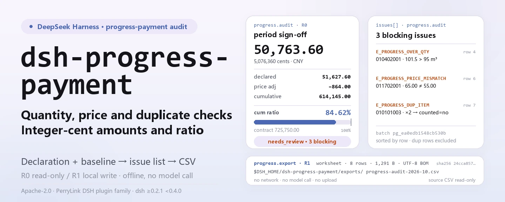
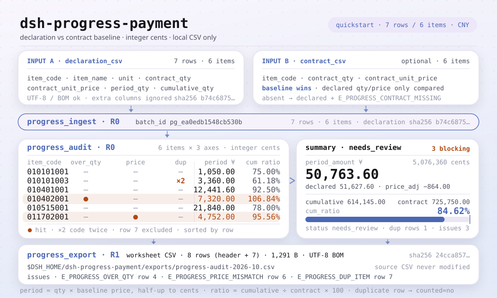

<div align="center">

<picture>
  <source media="(prefers-color-scheme: dark)" srcset="docs/assets/dsh-progress-payment-hero-en-dark.webp">
   95, price 65.00 ≠ 55.00, duplicate ×2 not counted) and the 8-row export strip (1,291 B, UTF-8 BOM, sha256); all numbers come from the quickstart fixture">
</picture>

# dsh-progress-payment

**Confirm this period's progress payment against the contract baseline: integer-cent amounts, cumulative ratio, over-quantity/price/duplicate issue list → review worksheet CSV.**

A local-only progress-payment audit tool for DeepSeek Harness: read one declaration CSV and an optional contract baseline CSV, check quantity and unit price line by line, compute the period amount, cumulative amount and cumulative ratio, then export a reviewable worksheet — no network, no model call, no upload.

[Install](#three-step-setup) · [Configuration](#configuration) · [FAQ](#faq) · [简体中文](README.md) · [English](README.en.md) · [Español](README.es.md) · [Português](README.pt.md) · [हिन्दी](README.hi.md)

[](LICENSE)
[](#compatibility)
[](https://www.npmjs.com/package/dsh-progress-payment)
[](https://github.com/PerryLink/dsh-progress-payment/actions/workflows/ci.yml)
[](#compatibility)

[](https://github.com/PerryLink/dsh-progress-payment/stargazers)
[](https://www.npmjs.com/package/dsh-progress-payment)

```sh
dsh plugin --profile <profile> add dsh-progress-payment
```

</div>

<sub>Community plugin, not affiliated with DeepSeek. Canonical repository: <https://github.com/PerryLink/dsh-progress-payment>.</sub>

<sub>Status: alpha / public-synthetic / partial / not counted / not GA — no customer data, no customer evidence, no production-readiness or audit-conclusion claim.</sub>

## What it is

Take the current-period progress-payment declaration submitted by a main contractor, subcontractor or owner, and check it line by line against the contract baseline: is any quantity over the contract, has a unit price been changed, does an item code appear twice? Then compute the period amount, cumulative amount and cumulative ratio in integer cents, and finish with a reviewable audit worksheet CSV.

- **Fits:** quantity surveyors, cost engineers and site supervisors auditing a monthly progress payment with tens to thousands of bill items; checking quantity and unit price before signing the certificate; keeping the declaration, contract baseline and issue list in one reviewable CSV; workflows that need stable error codes and a reproducible golden sample.
- **Does not fit:** replacing estimating/settlement software or legal advice; deciding whether a change order, claim, retention, tax or pay ratio is valid (this package flags over-quantity but does not approve variations); OCR of scanned PDFs or images (CSV only); independent quantity/price verification without a contract baseline (without a baseline the declared values are used and the gap is recorded in the issue list).

<picture>
  <source media="(prefers-color-scheme: dark)" srcset="docs/assets/dsh-progress-payment-flow-v5-dark.svg">
  
</picture>

## Three-step setup

1. **Install** (pick one channel):

   ```sh
   # npm channel (recommended; published releases)
   dsh plugin --profile <profile> add dsh-progress-payment
   # git channel (latest main; equivalent to git+https://github.com/PerryLink/dsh-progress-payment.git)
   dsh plugin --profile <profile> add github:PerryLink/dsh-progress-payment
   # tarball channel: pnpm pack in this repo, then
   dsh plugin --profile <profile> add ./dsh-progress-payment-<version>.tgz
   ```

2. **Minimal config** (no Config keys at all; `cordis.patch.yml` only inserts this row):

   ```yaml
   - insert:
       - id: dsh-progress-payment
         name: 'dsh-progress-payment'
   ```

3. **Verify it mounts**:

   ```sh
   dsh --profile <profile> --dump-config | grep dsh-progress-payment
   node samples/quickstart/run.mjs --check
   ```

**Uninstall**: `dsh plugin --profile <profile> remove dsh-progress-payment` (or remove the row from the profile patch).

## Core capabilities

Tool names are stable API; tool descriptions stay in English to match runtime output.

| Tool | Purpose | Risk |
|---|---|---|
| `progress.ingest` | Import the declaration CSV and optional contract baseline CSV; return `batch_id`, rows, item count and sha256; the batch lives in session memory only | R0 |
| `progress.audit` | Audit period amount, cumulative ratio, over-contract quantity, price mismatch, missing/mismatched baseline, cumulative-below-period and duplicate items; return the issue list; integer cents | R0 |
| `progress.export` | Re-run the audit and write the review worksheet CSV (UTF-8 BOM); return path, rows, bytes and sha256 | R1 local write |

- **Contract baseline wins** — when supplied, its quantities and prices are authoritative; the declaration's own contract quantity/price is only a cross-check, and a difference raises `E_PROGRESS_CONTRACT_MISMATCH` or `E_PROGRESS_PRICE_MISMATCH`.
- **Integer-cent money** — quantities up to 3 decimals, prices/amounts up to 2; every amount is computed in integer cents and rounded half-up at the cent, never by accumulating floats.
- **Cumulative view** — every item reports the period amount, cumulative amount, contract amount and cumulative ratio (2 decimals, 0 when the contract amount is zero); a ratio above 100% is the visible over-quantity signal.
- **Issues carry a next action** — 6 audit issue codes (`E_PROGRESS_*`) and 7 input/export error codes, each rendered as one sentence + code + one next action.
- **Review worksheet CSV** — one row per declaration line, with duplicate rows marked as not counted; UTF-8 BOM so Excel opens it cleanly, with a sha256 checksum.
- **Local only** — no network, no model call, no upload; the source CSVs are read-only and never modified.

## Input

- **Declaration CSV**: UTF-8 with a header row. Chinese and English headers both work; column order is free and extra columns are ignored. A UTF-8 BOM is accepted.

```text
清单编码,名称,单位,合同量,合同单价,本期完成量,累计完成量
item_code,item_name,unit,contract_qty,contract_unit_price,period_qty,cumulative_qty

清单编码,合同量,合同单价
item_code,contract_qty,contract_unit_price
```

- **Contract baseline CSV** (optional): `item_code,contract_qty,contract_unit_price`, optionally with name/unit columns; one row per item code, a duplicate raises `E_PROGRESS_CSV_ROW`. When supplied it is authoritative; otherwise the declared contract quantity/price is used.
- **Precision**: quantities up to 3 decimals, unit prices up to 2; contract quantity must be greater than 0; money is parsed as integer cents and `¥`, `￥` and thousands separators are ignored.
- **Sample**: `samples/quickstart/input/declaration-2026-10.csv` (7 rows / 6 bill items) and `contract-baseline.csv` (6 items). Synthetic only.

## Output

- `progress.ingest`: `batch_id`, `rows`, `items`, `contract_items`, `declaration_sha256`, `contract_sha256`. The `batch_id` is deterministic for the same CSV pair, but the batch lives in session memory only and is not persisted.
- `progress.audit`: `items[]` carries the contract quantity/price, period quantity, cumulative quantity, period amount, cumulative amount, contract amount, cumulative ratio and issue codes; `issues[]` is sorted by row; `summary` carries the period/declared/contract amounts, the price adjustment, the cumulative ratio, issue counts and `status` (`ok` / `needs_review`). All amounts are integer cents.
- `progress.export`: a review worksheet CSV (UTF-8 BOM, Excel-ready), one row per declaration line, duplicate rows marked as not counted; written under `$DSH_HOME/dsh-progress-payment/exports/`, returning path, rows, bytes and sha256. The worksheet header is:

```text
行号,清单编码,名称,单位,合同量,合同单价(元),本期完成量,累计完成量,本期金额(元),累计金额(元),累计比例(%),是否计入,问题代码,问题说明
```
- **The source CSVs are never modified**; nothing is uploaded and no network or model call is made.

### Audit rules

1. **Amount**: `period amount = period qty × contract unit price`, rounded half-up to whole cents; the cumulative amount is computed the same way. An amount beyond the JavaScript safe-integer range raises `E_PROGRESS_CSV_ROW`.
2. **Cumulative ratio**: `cumulative amount ÷ contract amount × 100`, two decimals; a zero contract amount yields 0.
3. **Over quantity**: `period_qty > contract_qty` or `cumulative_qty > contract_qty` → `E_PROGRESS_OVER_QTY`, distinguished by `kind` (`period_over_contract` / `cumulative_over_contract`).
4. **Price mismatch**: declared contract unit price ≠ baseline unit price → `E_PROGRESS_PRICE_MISMATCH`; `price_tolerance_bps` relaxes the comparison (default 0 = exact). The period amount is always recomputed at the baseline unit price.
5. **Cumulative > contract quantity**: the `cumulative_over_contract` kind; the ratio can exceed 100%. Over-quantity is not silently deducted — it needs a variation or settlement.
6. **Duplicate item**: the same item code appears more than once → `E_PROGRESS_DUP_ITEM`; only the first occurrence counts toward the period amount, and the other rows are marked as not counted in the worksheet.
7. **Missing / mismatched baseline**: `E_PROGRESS_CONTRACT_MISSING` / `E_PROGRESS_CONTRACT_MISMATCH`; a missing item falls back to the declared values and is flagged, so it must not be treated as verified.
8. **Cumulative below period**: `E_PROGRESS_QTY_INCONSISTENT`, usually a wrong opening cumulative.

## Example

Paste this one line into the agent:

```text
帮我审一下这期进度款申报，按合同基准核对超量和单价，把问题清单导成底稿。
```

Reproduce the bundled sample and compare with the golden file:

```sh
node samples/quickstart/run.mjs --check
```


This is a real run: 7 declaration rows / 6 bill items, period amount **50,763.60 CNY**, cumulative **614,145.00 CNY (84.62%)**, and 3 blocking issues — the rectangular column reached a cumulative 101.5 m³ against a 95 m³ contract, the formwork price was 65.00 against a 55.00 baseline, and one item code appeared twice. The worksheet has 8 rows (header + 7) and 1,291 bytes. `samples/quickstart/expected/result.json` is the real stdout of `node samples/quickstart/run.mjs --json`, not hand-written; the raw log is kept at [`docs/assets/quickstart.log`](docs/assets/quickstart.log).

## Configuration

This plugin has **no Config keys** — everything is tunable through the three tools' call parameters:

| Tool | Parameter | Required | Meaning |
|---|---|---|---|
| `progress.ingest` | `declaration_csv` | yes | Text content of the current-period declaration CSV |
| `progress.ingest` | `contract_csv` | no | Text content of the contract baseline CSV; without it the declared contract quantity/price is used |
| `progress.ingest` | `source_name` | no | Source label, default `declaration.csv`; identification only |
| `progress.audit` | `batch_id` | yes | Batch id returned by `progress.ingest` |
| `progress.audit` | `price_tolerance_bps` | no | Unit-price tolerance in basis points; default 0 (exact), a negative or NaN value raises `E_PROGRESS_OPTION_INVALID` |
| `progress.export` | `batch_id` | yes | Same as above |
| `progress.export` | `filename` | no | Export filename, `[A-Za-z0-9._-]` only, max 120 chars; defaults to `progress-audit-<batch short id>.csv` |
| `progress.export` | `price_tolerance_bps` | no | Unit-price tolerance for the re-run audit, default 0 |

Call examples (tool surface):

```sh
# 1) import the declaration (tool surface)
#    progress.ingest({ declaration_csv, contract_csv })

# 2) audit (tool surface)
#    progress.audit({ batch_id })

# 3) export the worksheet (tool surface)
#    progress.export({ batch_id, filename: "progress-audit-2026-10.csv" })
```

Tests can override the local write root with the `DSH_PROGRESS_PAYMENT_HOME` environment variable; the default is exactly `$DSH_HOME/dsh-progress-payment`.

## FAQ

<details>
<summary>Why does the period amount differ from my own calculation?</summary>

The audit prices every line at the **contract baseline unit price**, not the declared price. A declared price that differs raises `E_PROGRESS_PRICE_MISMATCH` and both amounts are reported (`declared_period_amount_cents` and `period_amount_cents`); the delta is `summary.price_adjustment_cents`. Quantity × price is rounded half-up to whole cents.

</details>

<details>
<summary>Which contract quantity is the ceiling?</summary>

The contract baseline wins when supplied; the declared contract quantity is used only when no baseline is given. Both `period_qty > contract_qty` and `cumulative_qty > contract_qty` raise `E_PROGRESS_OVER_QTY`, distinguished by `kind` (`period_over_contract` / `cumulative_over_contract`). Over-quantity is not silently deducted — it needs a variation or settlement.

</details>

<details>
<summary>Do duplicate item codes get paid twice?</summary>

No. Only the first occurrence counts toward the period amount; the other rows are marked as not counted in the worksheet and raise `E_PROGRESS_DUP_ITEM`. Which row is the right one still needs a human decision.

</details>

<details>
<summary>Does it modify or upload my CSV?</summary>

No. It reads the named CSVs, writes only under `$DSH_HOME/dsh-progress-payment/exports/`, and never uses the network, a model call or an upload. The `progress.ingest` batch lives in session memory, so a new session needs a fresh import.

</details>

<details>
<summary>Can it read Excel directly?</summary>

No. Save the sheet as **CSV UTF-8** first. Excel-written UTF-8 CSVs with a BOM are accepted; xlsx, PDF and scans are not supported.

</details>

## Permissions

Read: the declaration CSV and contract baseline CSV the user names (sample: `samples/quickstart/input/`); nothing else.
Write: `$DSH_HOME/dsh-progress-payment/exports/` (review worksheet CSV) only; source files are not modified.
Network: no.
External systems: none.

`progress.ingest` and `progress.audit` are **R0** (read-only; `ingest` keeps the batch in session memory and writes no file). `progress.export` is **R1** (local write under `$DSH_HOME/dsh-progress-payment/exports/`). `DSH_PROGRESS_PAYMENT_HOME` can override the local write root for tests; the default is exactly `$DSH_HOME/dsh-progress-payment`.

## Acceptance evidence

Public/synthetic fixtures live in `samples/quickstart/`; `ACCEPTANCE.csv` records the checks. Every row is `counted=false` except the quickstart row.

| req_id | metric | threshold | actual | pass | source | counted |
|---|---|---|---|---|---|---|
| PG-A02 | period amount (cents) | 5076360 | 5076360 | true | public/synthetic | false |
| PG-A06 | price mismatch | E_PROGRESS_PRICE_MISMATCH x1 | 1 | true | public/synthetic | false |
| PS1-QS01 | quickstart golden | 1/1 | 1 | true | synthetic/quickstart | true |

*Fixture-backed rows, not a customer run; no output is invented.*

## Limits and known limitations

- **Quantity/price only:** no judgement on variations, claims, retention, tax or pay ratios; those still need the contract and a human.
- **One price basis:** the declaration's `contract_unit_price` is the pricing basis; there is no current-price or index-price column.
- **No automatic duplicate choice:** duplicates are listed and only the first row is counted; a human must pick the right one.
- **Amount ceiling:** a single line must stay inside the JavaScript safe-integer range; otherwise `E_PROGRESS_CSV_ROW`.
- **CSV only:** no xlsx, PDF or scanned documents.
- Public/synthetic samples only; alpha/partial, not counted, no GA or production-readiness claim.

## Compatibility

| Surface | Status |
|---|---|
| Harness | `dsh >=0.2.1-rc.3 <0.4.0` |
| Node | `>=24.9.0 <25` |
| Platforms | All; local files only |
| Data | No network, no model call, no upload |

## Ecosystem & quality

- [npm package page](https://www.npmjs.com/package/dsh-progress-payment) (version and downloads)
- [CI workflow](https://github.com/PerryLink/dsh-progress-payment/actions/workflows/ci.yml) (`ci.yml`: build, lint, typecheck, tests, acceptance gate)
- [Troubleshooting](TROUBLESHOOTING.md) (10 real failure paths written as symptom / cause / action)
- [Ecosystem knowledge base](https://perrylink.github.io/dsh-plugin-guide/) — plugin development guide · measured selection data · maintenance criteria

## Related work

- [dsh-ifc-qto](https://github.com/PerryLink/dsh-ifc-qto) (model quantities, a cross-check for declared quantities)
- [dsh-ap-three-way](https://github.com/PerryLink/dsh-ap-three-way) (payment invoice / PO / GRN three-way match)
- [Domain index](https://perrylink.github.io/dsh-plugins/)

## Development

```sh
pnpm install --frozen-lockfile
pnpm build && pnpm lint && pnpm typecheck
node --test test/*.test.mjs
node scripts/gate.mjs
```

Current version `0.1.0`; 32 tests pass (`node --test test/*.test.mjs`). Release gate `node scripts/gate.mjs` = metadata lint + every public acceptance row passing + the counted quickstart row present. The banner and the structure diagram are generated programmatically by [`scripts/gen-readme-assets.py`](scripts/gen-readme-assets.py) (Pillow for the four 1440x576 webp banners, hand-written SVG for the 1100x660 structure diagram; every number is copied from `samples/quickstart/expected/result.json`; no benchmark data exists, so no evidence chart is emitted) and both are safe to re-run; `docs/assets/quickstart.png` is a real captured screenshot, kept together with `docs/assets/quickstart.log`.

Topics: `dsh`, `dsh-plugin`, `deepseek-harness`, `progress-payment`, `construction`, `quantity-surveying`, `csv`, `perrylink`

## Family & thanks

This project is part of the DeepSeek Harness plugin family from [PerryLink](https://github.com/PerryLink) (all Apache-2.0). If it is useful, **a star helps the next person find it** — nothing is gated behind it.

- [@PerryLink](https://github.com/PerryLink) — creator and maintainer: the progress-payment audit engine, integer-cent money, the CSV parser and worksheet exporter, the three tool surfaces, the quickstart golden sample and the five-language docs.

## License

[LICENSE](LICENSE) (Apache License 2.0) © 2026 dsh-progress-payment contributors. See also `NOTICE` and `THIRD-PARTY-NOTICES`.

<p align="center"><sub>Apache-2.0 · Community plugin, not affiliated with DeepSeek.</sub></p>
