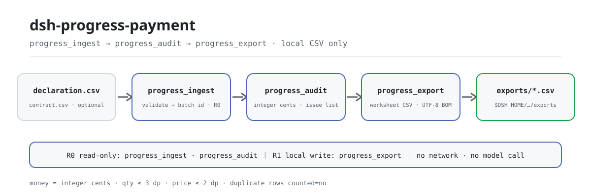
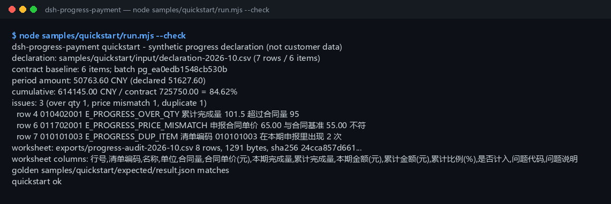

<div align="center">

<picture>
  <source media="(prefers-color-scheme: dark)" srcset="docs/assets/dsh-progress-payment-flow-dark.svg">
  
</picture>

# dsh-progress-payment

**Confirma el pago por avance del periodo contra la línea base del contrato: importes en céntimos enteros, ratio acumulado y lista de problemas (exceso de cantidad, precio distinto, partidas duplicadas) → CSV de hoja de revisión.**

Una herramienta puramente local de auditoría de pagos por avance para DeepSeek Harness: lee un CSV de declaración y, opcionalmente, un CSV de línea base del contrato; verifica cantidad y precio partida por partida; calcula el importe del periodo, el acumulado y el ratio acumulado; y exporta una hoja revisable — sin red, sin llamadas al modelo, sin subidas.

[Instalar](#instalación-en-tres-pasos) · [Configuración](#configuración) · [FAQ](#faq) · [简体中文](README.md) · [English](README.en.md) · [Español](README.es.md) · [Português](README.pt.md) · [हिन्दी](README.hi.md)

[](LICENSE)
[](#compatibilidad)
[](https://www.npmjs.com/package/dsh-progress-payment)
[](https://github.com/PerryLink/dsh-progress-payment/actions/workflows/ci.yml)
[](#compatibilidad)

[](https://github.com/PerryLink/dsh-progress-payment/stargazers)
[](https://www.npmjs.com/package/dsh-progress-payment)

```sh
dsh plugin --profile <profile> add dsh-progress-payment
```

</div>

<sub>Plugin de la comunidad, no afiliado a DeepSeek. Repositorio canónico: <https://github.com/PerryLink/dsh-progress-payment>.</sub>

<sub>Estado: alpha / público-sintético / partial / not counted / no GA — sin datos de clientes, sin evidencia de clientes y sin declaración de idoneidad para producción ni de conclusión de auditoría.</sub>

## Qué es

Toma la declaración de pago por avance del periodo que presenta el contratista principal, el subcontratista o el propietario y la contrasta con la línea base del contrato: ¿alguna cantidad supera el contrato?, ¿se ha cambiado algún precio unitario?, ¿aparece dos veces algún código de partida? Después calcula en céntimos enteros el importe del periodo, el importe acumulado y el ratio acumulado, y termina con un CSV de hoja de revisión.

- **Encaja**: aparejadores, ingenieros de costes y supervisores de obra que auditan un pago mensual con decenas a miles de partidas; comprobar cantidad y precio antes de firmar el certificado; conservar declaración, línea base y lista de problemas en un único CSV revisable; flujos que necesitan códigos de error estables y un ejemplo dorado reproducible.
- **No encaja**: sustituir software de medición o liquidación, o asesoramiento legal; decidir si una modificación, reclamación, retención, impuesto o ratio de pago es válido (este paquete señala el exceso de cantidad pero no aprueba variaciones); OCR de PDF escaneados o imágenes (solo CSV); verificación independiente de cantidad y precio sin línea base del contrato (sin línea base se usan los valores declarados y la carencia queda registrada en la lista de problemas).

## Instalación en tres pasos

1. **Instala** (elige un canal):

   ```sh
   # canal npm (recomendado; versiones publicadas)
   dsh plugin --profile <profile> add dsh-progress-payment
   # canal git (último main; equivalente a git+https://github.com/PerryLink/dsh-progress-payment.git)
   dsh plugin --profile <profile> add github:PerryLink/dsh-progress-payment
   # canal tarball: pnpm pack en este repo y luego
   dsh plugin --profile <profile> add ./dsh-progress-payment-<version>.tgz
   ```

2. **Configuración mínima** (no hay ninguna clave de Config; `cordis.patch.yml` solo inserta esta fila):

   ```yaml
   - insert:
       - id: dsh-progress-payment
         name: 'dsh-progress-payment'
   ```

3. **Verifica que se monta**:

   ```sh
   dsh --profile <profile> --dump-config | grep dsh-progress-payment
   node samples/quickstart/run.mjs --check
   ```

**Desinstalar**: `dsh plugin --profile <profile> remove dsh-progress-payment` (o elimina la fila del patch del perfil).

## Capacidades clave

Los nombres de las herramientas son API estable; sus descripciones se mantienen en inglés para coincidir con la salida en tiempo de ejecución.

| Herramienta | Propósito | Riesgo |
|---|---|---|
| `progress.ingest` | Importa el CSV de declaración y el CSV opcional de línea base; devuelve `batch_id`, filas, número de partidas y sha256; el lote solo vive en la memoria de la sesión | R0 |
| `progress.audit` | Audita importe del periodo, ratio acumulado, cantidad sobre contrato, precio distinto, línea base ausente o distinta, acumulado menor que el periodo y partidas duplicadas; devuelve la lista de problemas; céntimos enteros | R0 |
| `progress.export` | Reejecuta la auditoría y escribe el CSV de hoja de revisión (UTF-8 BOM); devuelve ruta, filas, bytes y sha256 | R1 escritura local |

- **Manda la línea base** — si se aporta, sus cantidades y precios son la autoridad; la cantidad/precio de contrato declarados solo sirven de contraste, y una diferencia genera `E_PROGRESS_CONTRACT_MISMATCH` o `E_PROGRESS_PRICE_MISMATCH`.
- **Dinero en céntimos enteros** — cantidades hasta 3 decimales, precios/importes hasta 2; todo importe se calcula en céntimos enteros y se redondea al céntimo, sin acumular errores de coma flotante.
- **Vista acumulada** — cada partida informa del importe del periodo, el importe acumulado, el importe de contrato y el ratio acumulado (2 decimales, 0 si el importe de contrato es cero); un ratio superior al 100% es la señal visible de exceso.
- **Problemas con siguiente acción** — 6 códigos de problema de auditoría (`E_PROGRESS_*`) y 7 códigos de error de entrada/exportación, cada uno como una frase + código + una acción siguiente.
- **CSV de hoja de revisión** — una fila por línea de declaración, las duplicadas marcadas `是否计入=否`; UTF-8 BOM para que Excel lo abra bien, con checksum sha256.
- **Solo local** — sin red, sin llamadas al modelo, sin subidas; los CSV de origen son de solo lectura y nunca se modifican.

## Entrada

- **CSV de declaración**: UTF-8 con fila de cabecera. Funcionan cabeceras en chino y en inglés; el orden de columnas es libre y las columnas extra se ignoran. Se acepta BOM UTF-8.

```text
清单编码,名称,单位,合同量,合同单价,本期完成量,累计完成量
item_code,item_name,unit,contract_qty,contract_unit_price,period_qty,cumulative_qty
```

- **CSV de línea base del contrato** (opcional): `item_code,contract_qty,contract_unit_price` (o `清单编码,合同量,合同单价`), con columnas opcionales de nombre/unidad; una fila por código de partida y un duplicado genera `E_PROGRESS_CSV_ROW`. Si se aporta, es la autoridad; si no, se usan la cantidad y el precio declarados.
- **Precisión**: cantidades hasta 3 decimales, precios unitarios hasta 2; la cantidad de contrato debe ser mayor que 0; el dinero se parsea como céntimos enteros y se ignoran `¥`, `￥` y los separadores de miles.
- **Ejemplo**: `samples/quickstart/input/declaration-2026-10.csv` (7 filas / 6 partidas) y `contract-baseline.csv` (6 partidas). Solo datos sintéticos.

## Salida

- `progress.ingest`: `batch_id`, `rows`, `items`, `contract_items`, `declaration_sha256`, `contract_sha256`. El `batch_id` es determinista para el mismo par de CSV, pero el lote solo vive en la memoria de la sesión y no se persiste.
- `progress.audit`: `items[]` con cantidad/precio de contrato, cantidad del periodo, cantidad acumulada, importe del periodo, importe acumulado, importe de contrato, ratio acumulado y códigos de problema; `issues[]` ordenado por fila; `summary` con importes del periodo/declarado/contrato, ajuste de precio, ratio acumulado, recuentos y `status` (`ok` / `needs_review`). Todos los importes son céntimos enteros.
- `progress.export`: CSV de hoja de revisión (UTF-8 BOM, listo para Excel) con cabecera `行号,清单编码,名称,单位,合同量,合同单价(元),本期完成量,累计完成量,本期金额(元),累计金额(元),累计比例(%),是否计入,问题代码,问题说明`; una fila por línea de declaración, las duplicadas marcadas `是否计入=否`; se escribe en `$DSH_HOME/dsh-progress-payment/exports/` y devuelve ruta, filas, bytes y sha256.
- **Los CSV de origen nunca se modifican**; no se sube nada y no hay red ni llamada al modelo.

### Reglas de auditoría

1. **Importe**: `importe del periodo = cantidad del periodo × precio unitario de contrato`, redondeado al céntimo entero; el importe acumulado se calcula igual. Un importe fuera del rango entero seguro de JavaScript genera `E_PROGRESS_CSV_ROW`.
2. **Ratio acumulado**: `importe acumulado ÷ importe de contrato × 100`, 2 decimales; un importe de contrato cero devuelve 0.
3. **Exceso de cantidad**: `period_qty > contract_qty` o `cumulative_qty > contract_qty` → `E_PROGRESS_OVER_QTY`, distinguido por `kind` (`period_over_contract` / `cumulative_over_contract`).
4. **Precio distinto**: precio unitario declarado ≠ precio de la línea base → `E_PROGRESS_PRICE_MISMATCH`; `price_tolerance_bps` relaja la comparación (0 por defecto = exacta). El importe del periodo siempre se recalcula al precio de la línea base.
5. **Acumulado > cantidad de contrato**: la variante `cumulative_over_contract`; el ratio puede superar el 100%. El exceso no se deduce automáticamente: requiere modificación o liquidación.
6. **Partida duplicada**: el mismo código aparece más de una vez → `E_PROGRESS_DUP_ITEM`; solo cuenta la primera aparición y las demás se marcan `是否计入=否` en la hoja.
7. **Línea base ausente o distinta**: `E_PROGRESS_CONTRACT_MISSING` / `E_PROGRESS_CONTRACT_MISMATCH`; si falta una partida se usan los valores declarados y se marca, así que no debe tratarse como verificado.
8. **Acumulado menor que el periodo**: `E_PROGRESS_QTY_INCONSISTENT`, normalmente un acumulado inicial mal informado.

## Ejemplo

Copia esta frase en el agente:

```text
帮我审一下这期进度款申报，按合同基准核对超量和单价，把问题清单导成底稿。
```

Reproduce el ejemplo incluido y compara con el archivo dorado:

```sh
node samples/quickstart/run.mjs --check
```



Es una ejecución real: 7 filas de declaración / 6 partidas, importe del periodo **50.763,60 CNY**, acumulado **614.145,00 CNY (84,62%)** y 3 problemas bloqueantes: la columna rectangular llegó a 101,5 m³ acumulados frente a 95 m³ de contrato, el precio del encofrado era 65,00 frente a 55,00 de la línea base, y un código apareció dos veces. La hoja tiene 8 filas (cabecera + 7) y 1.291 bytes. `samples/quickstart/expected/result.json` es la salida real de `node samples/quickstart/run.mjs --json`, no está escrito a mano; el registro original está en [`docs/assets/quickstart.log`](docs/assets/quickstart.log).

## Configuración

Este plugin **no tiene claves de Config** — todo se ajusta con los parámetros de llamada de las tres herramientas:

| Herramienta | Parámetro | Obligatorio | Significado |
|---|---|---|---|
| `progress.ingest` | `declaration_csv` | sí | Contenido de texto del CSV de declaración del periodo |
| `progress.ingest` | `contract_csv` | no | Contenido de texto del CSV de línea base; sin él se usan la cantidad y el precio declarados |
| `progress.ingest` | `source_name` | no | Etiqueta de origen, por defecto `declaration.csv`; solo identificativa |
| `progress.audit` | `batch_id` | sí | Id de lote devuelto por `progress.ingest` |
| `progress.audit` | `price_tolerance_bps` | no | Tolerancia de precio unitario en puntos básicos; 0 por defecto (exacta); un valor negativo o NaN genera `E_PROGRESS_OPTION_INVALID` |
| `progress.export` | `batch_id` | sí | Igual que arriba |
| `progress.export` | `filename` | no | Nombre del archivo, solo `[A-Za-z0-9._-]`, máx. 120 caracteres; por defecto `progress-audit-<id corto>.csv` |
| `progress.export` | `price_tolerance_bps` | no | Tolerancia para la reejecución de la auditoría, 0 por defecto |

Ejemplos de llamada (superficie de herramientas):

```sh
# 1) importar la declaración (superficie de herramientas)
#    progress.ingest({ declaration_csv, contract_csv })

# 2) auditar (superficie de herramientas)
#    progress.audit({ batch_id })

# 3) exportar la hoja (superficie de herramientas)
#    progress.export({ batch_id, filename: "progress-audit-2026-10.csv" })
```

Las pruebas pueden sobrescribir la raíz de escritura local con la variable de entorno `DSH_PROGRESS_PAYMENT_HOME`; por defecto es exactamente `$DSH_HOME/dsh-progress-payment`.

## FAQ

<details>
<summary>¿Por qué el importe del periodo no coincide con mi cálculo?</summary>

La auditoría valora cada línea al **precio unitario de la línea base del contrato**, no al precio declarado. Un precio declarado distinto genera `E_PROGRESS_PRICE_MISMATCH` y se informan ambos importes (`declared_period_amount_cents` y `period_amount_cents`); la diferencia está en `summary.price_adjustment_cents`. Cantidad × precio se redondea al céntimo entero.

</details>

<details>
<summary>¿Qué cantidad de contrato es el techo?</summary>

Manda la línea base cuando se aporta; la cantidad declarada solo se usa si no hay línea base. Tanto `period_qty > contract_qty` como `cumulative_qty > contract_qty` generan `E_PROGRESS_OVER_QTY`, distinguidos por `kind` (`period_over_contract` / `cumulative_over_contract`). El exceso no se deduce automáticamente del importe: requiere modificación o liquidación.

</details>

<details>
<summary>¿Las partidas duplicadas se pagan dos veces?</summary>

No. Solo la primera aparición cuenta para el importe del periodo; las demás se marcan `是否计入=否` en la hoja y generan `E_PROGRESS_DUP_ITEM`. Decidir cuál es la fila correcta sigue siendo una decisión humana.

</details>

<details>
<summary>¿Modifica o sube mis CSV?</summary>

No. Solo lee los CSV indicados, escribe únicamente en `$DSH_HOME/dsh-progress-payment/exports/` y nunca usa la red, una llamada al modelo ni una subida. El lote de `progress.ingest` vive en la memoria de la sesión, así que una sesión nueva necesita importarlo de nuevo.

</details>

<details>
<summary>¿Puede leer Excel directamente?</summary>

No. Guarda primero la hoja como **CSV UTF-8**. Se aceptan CSV UTF-8 con BOM; no se admiten xlsx, PDF ni escaneos.

</details>

## Permisos

Lectura: los CSV de declaración y de línea base que indique el usuario (ejemplo: `samples/quickstart/input/`); nada más.
Escritura: solo `$DSH_HOME/dsh-progress-payment/exports/` (CSV de hoja de revisión); los archivos de origen no se modifican.
Red: no.
Sistemas externos: ninguno.

`progress.ingest` y `progress.audit` son **R0** (solo lectura; `ingest` mantiene el lote en memoria de sesión y no escribe archivos). `progress.export` es **R1** (escritura local en `$DSH_HOME/dsh-progress-payment/exports/`). `DSH_PROGRESS_PAYMENT_HOME` puede sobrescribir la raíz de escritura local para pruebas; por defecto es exactamente `$DSH_HOME/dsh-progress-payment`.

## Evidencia de aceptación

Los fixtures públicos/sintéticos están en `samples/quickstart/`; `ACCEPTANCE.csv` registra las comprobaciones. Todas las filas son `counted=false` excepto la de quickstart.

| req_id | metric | threshold | actual | pass | source | counted |
|---|---|---|---|---|---|---|
| PG-A02 | period amount (cents) | 5076360 | 5076360 | true | public/synthetic | false |
| PG-A06 | price mismatch | E_PROGRESS_PRICE_MISMATCH x1 | 1 | true | public/synthetic | false |
| PS1-QS01 | quickstart golden | 1/1 | 1 | true | synthetic/quickstart | true |

*Filas respaldadas por fixtures, no una ejecución de cliente; no se inventa ninguna salida.*

## Límites y limitaciones conocidas

- **Solo cantidad y precio:** no juzga modificaciones, reclamaciones, retenciones, impuestos ni ratios de pago; eso sigue necesitando el contrato y una persona.
- **Una sola base de precio:** el `contract_unit_price` de la declaración es la base de valoración; no hay columna de precio actual ni de índice.
- **Sin elección automática de duplicados:** los duplicados se listan y solo cuenta la primera fila; una persona debe elegir la correcta.
- **Tope de importe:** cada línea debe caber en el rango entero seguro de JavaScript; si no, `E_PROGRESS_CSV_ROW`.
- **Solo CSV:** no xlsx, PDF ni documentos escaneados.
- Solo ejemplos públicos/sintéticos; alpha/partial, not counted, sin GA ni declaración de idoneidad para producción.

## Compatibilidad

| Dimensión | Estado |
|---|---|
| Harness | `dsh >=0.2.1-rc.3 <0.4.0` |
| Node | `>=24.9.0 <25` |
| Plataformas | Todas; solo archivos locales |
| Datos | Sin red, sin llamadas al modelo, sin subidas |

## Ecosistema y calidad

- [Página del paquete npm](https://www.npmjs.com/package/dsh-progress-payment) (versión y descargas)
- [Flujo de CI](https://github.com/PerryLink/dsh-progress-payment/actions/workflows/ci.yml) (`ci.yml`: build, lint, typecheck, pruebas y puerta de aceptación)
- [Solución de problemas](TROUBLESHOOTING.md) (10 fallos reales escritos como síntoma / causa / acción)
- [Base de conocimiento del ecosistema](https://perrylink.github.io/dsh-plugin-guide/) — guía de desarrollo de plugins · datos de selección medidos · criterios de mantenimiento

## Trabajo relacionado

- [dsh-ifc-qto](https://github.com/PerryLink/dsh-ifc-qto) (cantidades del modelo, contraste para las cantidades declaradas)
- [dsh-ap-three-way](https://github.com/PerryLink/dsh-ap-three-way) (conciliación triple factura / pedido / albarán)
- [Índice de dominio](https://perrylink.github.io/dsh-plugins/)

## Desarrollo

```sh
pnpm install --frozen-lockfile
pnpm build && pnpm lint && pnpm typecheck
node --test test/*.test.mjs
node scripts/gate.mjs
```

Versión actual `0.1.0`; 32 pruebas pasan (`node --test test/*.test.mjs`). Puerta de publicación `node scripts/gate.mjs` = lint de metadatos + todas las filas públicas de aceptación en verde + la fila contada de quickstart presente. El diagrama de cabecera lo genera [`scripts/gen-readme-assets.py`](scripts/gen-readme-assets.py) (biblioteca estándar de Python, SVG puro, etiquetas de tokens de comando, par claro/oscuro; no hay datos de benchmark, así que no se genera gráfico de evidencia) y se puede volver a ejecutar; `docs/assets/quickstart.png` es una captura real, conservada junto a `docs/assets/quickstart.log`.

Topics: `dsh`, `dsh-plugin`, `deepseek-harness`, `progress-payment`, `construction`, `quantity-surveying`, `csv`, `perrylink`

## Familia y agradecimientos

Este proyecto forma parte de la familia de plugins de DeepSeek Harness mantenida por [PerryLink](https://github.com/PerryLink) (todos Apache-2.0). Si te resulta útil, **una estrella ayuda a que la siguiente persona lo encuentre** — no desbloquea ninguna función.

- [@PerryLink](https://github.com/PerryLink) — creador y mantenedor: el motor de auditoría de pagos por avance, el dinero en céntimos enteros, el parser CSV y el exportador de hojas, las tres superficies de herramientas, el ejemplo dorado de quickstart y la documentación en cinco idiomas.

## Licencia

[LICENSE](LICENSE) (Apache License 2.0) © 2026 dsh-progress-payment contributors. Véase también `NOTICE` y `THIRD-PARTY-NOTICES`.

<p align="center"><sub>Apache-2.0 · Plugin de la comunidad, no afiliado a DeepSeek.</sub></p>
