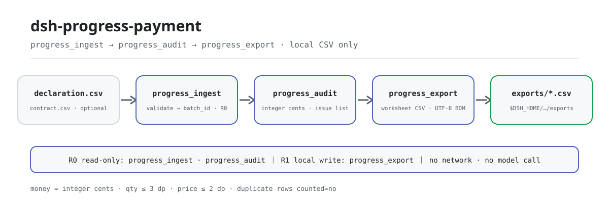

<div align="center">

<picture>
  <source media="(prefers-color-scheme: dark)" srcset="docs/assets/dsh-progress-payment-flow-dark.svg">
  
</picture>

# dsh-progress-payment

**अनुबंध आधार-रेखा के हिसाब से इस अवधि का प्रगति-भुगतान तय करें: पूर्णांक सेंट में राशि, संचयी अनुपात, अधिक मात्रा/दर/दोहराई गई मदों की समस्या-सूची → समीक्षा वर्कशीट CSV।**

DeepSeek Harness के लिए पूरी तरह लोकल प्रगति-भुगतान ऑडिट टूल: एक घोषणा CSV और वैकल्पिक अनुबंध आधार-रेखा CSV पढ़ता है, हर मद की मात्रा और इकाई दर जाँचता है, अवधि राशि, संचयी राशि और संचयी अनुपात निकालता है, और अंत में एक समीक्षा-योग्य वर्कशीट निर्यात करता है — कोई नेटवर्क नहीं, कोई मॉडल कॉल नहीं, कोई अपलोड नहीं।

[इंस्टॉल](#तीन-चरणों-में-शुरुआत) · [कॉन्फ़िगरेशन](#कॉन्फ़िगरेशन) · [FAQ](#faq) · [简体中文](README.md) · [English](README.en.md) · [Español](README.es.md) · [Português](README.pt.md) · [हिन्दी](README.hi.md)

[](LICENSE)
[](#संगतता)
[](https://www.npmjs.com/package/dsh-progress-payment)
[](https://github.com/PerryLink/dsh-progress-payment/actions/workflows/ci.yml)
[](#संगतता)

[](https://github.com/PerryLink/dsh-progress-payment/stargazers)
[](https://www.npmjs.com/package/dsh-progress-payment)

```sh
dsh plugin --profile <profile> add dsh-progress-payment
```

</div>

<sub>सामुदायिक प्लगइन, DeepSeek से असंबद्ध। कैननिकल रिपॉज़िटरी: <https://github.com/PerryLink/dsh-progress-payment>।</sub>

<sub>स्थिति: alpha / सार्वजनिक-सिंथेटिक / partial / not counted / GA नहीं — कोई ग्राहक डेटा नहीं, कोई ग्राहक साक्ष्य नहीं, और प्रोडक्शन-तैयारी या ऑडिट-निष्कर्ष का कोई दावा नहीं।</sub>

## यह क्या है

मुख्य ठेकेदार, उप-ठेकेदार या मालिक की इस अवधि की प्रगति-भुगतान घोषणा लें और उसे अनुबंध आधार-रेखा के सामने मद-दर-मद जाँचें: कोई मात्रा अनुबंध से अधिक है क्या, कोई इकाई दर बदली गई है क्या, कोई मद कोड दो बार आया है क्या? फिर पूर्णांक सेंट में अवधि राशि, संचयी राशि और संचयी अनुपात निकालें, और अंत में समीक्षा-योग्य ऑडिट वर्कशीट CSV दें।

- **उपयुक्त**: मात्रा सर्वेक्षक, लागत इंजीनियर और साइट सुपरवाइज़र जो दसियों से हज़ारों मदों वाले मासिक प्रगति-भुगतान का ऑडिट करते हैं; प्रमाणपत्र पर हस्ताक्षर से पहले मात्रा और इकाई दर जाँचना; घोषणा, अनुबंध आधार-रेखा और समस्या-सूची को एक समीक्षा-योग्य CSV में रखना; स्थिर त्रुटि कोड और दोबारा चलाने योग्य गोल्डन सैंपल चाहने वाले वर्कफ़्लो।
- **अनुपयुक्त**: मापन/निपटान सॉफ़्टवेयर या कानूनी सलाह का विकल्प; यह तय करना कि कोई परिवर्तन आदेश, दावा, रोक, कर या भुगतान अनुपात मान्य है या नहीं (यह पैकेज अधिक मात्रा दिखाता है, परिवर्तन को मंज़ूरी नहीं देता); स्कैन किए PDF या चित्रों का OCR (केवल CSV); अनुबंध आधार-रेखा के बिना स्वतंत्र मात्रा-दर सत्यापन (आधार-रेखा के बिना घोषित मान ही उपयोग होते हैं और यह कमी समस्या-सूची में दर्ज रहती है)।

## तीन चरणों में शुरुआत

1. **इंस्टॉल करें** (एक चैनल चुनें):

   ```sh
   # npm चैनल (अनुशंसित; प्रकाशित संस्करण)
   dsh plugin --profile <profile> add dsh-progress-payment
   # git चैनल (नवीनतम main; git+https://github.com/PerryLink/dsh-progress-payment.git के समतुल्य)
   dsh plugin --profile <profile> add github:PerryLink/dsh-progress-payment
   # tarball चैनल: इस रेपो में pnpm pack, फिर
   dsh plugin --profile <profile> add ./dsh-progress-payment-<version>.tgz
   ```

2. **न्यूनतम कॉन्फ़िगरेशन** (कोई Config कुंजी नहीं; `cordis.patch.yml` केवल यह पंक्ति जोड़ता है):

   ```yaml
   - insert:
       - id: dsh-progress-payment
         name: 'dsh-progress-payment'
   ```

3. **सत्यापित करें कि माउंट हुआ**:

   ```sh
   dsh --profile <profile> --dump-config | grep dsh-progress-payment
   node samples/quickstart/run.mjs --check
   ```

**अनइंस्टॉल**: `dsh plugin --profile <profile> remove dsh-progress-payment` (या प्रोफ़ाइल पैच से यह पंक्ति हटाएँ)।

## मुख्य क्षमताएँ

टूल नाम स्थिर API हैं; टूल विवरण रनटाइम आउटपुट से मेल खाने के लिए अंग्रेज़ी में रखे गए हैं।

| टूल | उद्देश्य | जोखिम |
|---|---|---|
| `progress.ingest` | घोषणा CSV और वैकल्पिक अनुबंध आधार-रेखा CSV आयात करता है; `batch_id`, पंक्तियाँ, मदों की संख्या और sha256 लौटाता है; बैच केवल सत्र मेमोरी में रहता है | R0 |
| `progress.audit` | अवधि राशि, संचयी अनुपात, अनुबंध से अधिक मात्रा, दर में अंतर, आधार-रेखा अनुपस्थित/अलग, संचयी अवधि से कम और दोहराई गई मदों का ऑडिट; समस्या-सूची लौटाता है; पूर्णांक सेंट | R0 |
| `progress.export` | ऑडिट दोबारा चलाकर समीक्षा वर्कशीट CSV (UTF-8 BOM) लिखता है; पथ, पंक्तियाँ, बाइट और sha256 लौटाता है | R1 लोकल लेखन |

- **अनुबंध आधार-रेखा ही प्रमाण** — दी गई हो तो उसकी मात्रा और दर ही अधिकारिक हैं; घोषणा में लिखी अनुबंध मात्रा/दर केवल मिलान के लिए है, और अंतर `E_PROGRESS_CONTRACT_MISMATCH` या `E_PROGRESS_PRICE_MISMATCH` देता है।
- **पूर्णांक सेंट में पैसा** — मात्रा अधिकतम 3 दशमलव, दर/राशि अधिकतम 2; हर राशि पूर्णांक सेंट में गिनी जाती है और सेंट पर राउंड होती है, फ़्लोटिंग-पॉइंट जोड़ कभी नहीं।
- **संचयी दृष्टि** — हर मद अवधि राशि, संचयी राशि, अनुबंध राशि और संचयी अनुपात (2 दशमलव, अनुबंध राशि शून्य हो तो 0) देती है; 100% से ऊपर अनुपात अधिक मात्रा का सीधा संकेत है।
- **समस्या के साथ अगला कदम** — 6 ऑडिट समस्या कोड (`E_PROGRESS_*`) और 7 इनपुट/निर्यात त्रुटि कोड, हर एक «एक वाक्य + कोड + एक अगला कदम» के रूप में।
- **समीक्षा वर्कशीट CSV** — हर घोषणा पंक्ति के लिए एक पंक्ति, दोहराई गईं `是否计入=否` से चिह्नित; UTF-8 BOM जिससे Excel सीधे खोलता है, साथ में sha256।
- **केवल लोकल** — कोई नेटवर्क नहीं, कोई मॉडल कॉल नहीं, कोई अपलोड नहीं; स्रोत CSV केवल-पढ़ने योग्य हैं और कभी नहीं बदलते।

## इनपुट

- **घोषणा CSV**: UTF-8, हेडर पंक्ति के साथ। चीनी और अंग्रेज़ी हेडर दोनों चलते हैं; स्तंभों का क्रम मुक्त है और अतिरिक्त स्तंभ छोड़ दिए जाते हैं। UTF-8 BOM स्वीकार्य है।

```text
清单编码,名称,单位,合同量,合同单价,本期完成量,累计完成量
item_code,item_name,unit,contract_qty,contract_unit_price,period_qty,cumulative_qty
```

- **अनुबंध आधार-रेखा CSV** (वैकल्पिक): `item_code,contract_qty,contract_unit_price` (या `清单编码,合同量,合同单价`), वैकल्पिक नाम/इकाई स्तंभों के साथ; हर मद कोड के लिए एक पंक्ति, दोहराव `E_PROGRESS_CSV_ROW` देता है। दी गई हो तो वही अधिकारिक है; न हो तो घोषित अनुबंध मात्रा/दर उपयोग होती है।
- **परिशुद्धता**: मात्रा अधिकतम 3 दशमलव, इकाई दर अधिकतम 2; अनुबंध मात्रा शून्य से बड़ी होनी चाहिए; पैसा पूर्णांक सेंट में पढ़ा जाता है और `¥`, `￥` तथा हज़ार विभाजक छोड़ दिए जाते हैं।
- **नमूना**: `samples/quickstart/input/declaration-2026-10.csv` (7 पंक्तियाँ / 6 मदें) और `contract-baseline.csv` (6 मदें)। केवल सिंथेटिक डेटा।

## आउटपुट

- `progress.ingest`: `batch_id`, `rows`, `items`, `contract_items`, `declaration_sha256`, `contract_sha256`। एक ही CSV जोड़ी के लिए `batch_id` निर्धारक है, पर बैच केवल सत्र मेमोरी में रहता है और सहेजा नहीं जाता।
- `progress.audit`: `items[]` में अनुबंध मात्रा/दर, अवधि मात्रा, संचयी मात्रा, अवधि राशि, संचयी राशि, अनुबंध राशि, संचयी अनुपात और समस्या कोड; `issues[]` पंक्ति क्रम में; `summary` में अवधि/घोषित/अनुबंध राशि, दर समायोजन, संचयी अनुपात, समस्या गिनती और `status` (`ok` / `needs_review`)। सभी राशियाँ पूर्णांक सेंट में।
- `progress.export`: समीक्षा वर्कशीट CSV (UTF-8 BOM, Excel-तैयार) जिसका हेडर `行号,清单编码,名称,单位,合同量,合同单价(元),本期完成量,累计完成量,本期金额(元),累计金额(元),累计比例(%),是否计入,问题代码,问题说明` है; हर घोषणा पंक्ति के लिए एक पंक्ति, दोहराई गईं `是否计入=否`; `$DSH_HOME/dsh-progress-payment/exports/` में लिखा जाता है और पथ, पंक्तियाँ, बाइट और sha256 लौटाता है।
- **स्रोत CSV कभी नहीं बदलते**; कुछ अपलोड नहीं होता और कोई नेटवर्क या मॉडल कॉल नहीं होता।

### ऑडिट नियम

1. **राशि**: `अवधि राशि = अवधि मात्रा × अनुबंध इकाई दर`, पूर्ण सेंट पर राउंड; संचयी राशि भी इसी तरह। JavaScript की सुरक्षित पूर्णांक सीमा से बाहर राशि `E_PROGRESS_CSV_ROW` देती है।
2. **संचयी अनुपात**: `संचयी राशि ÷ अनुबंध राशि × 100`, 2 दशमलव; अनुबंध राशि शून्य हो तो 0।
3. **अधिक मात्रा**: `period_qty > contract_qty` या `cumulative_qty > contract_qty` → `E_PROGRESS_OVER_QTY`, `kind` से अलग (`period_over_contract` / `cumulative_over_contract`)।
4. **दर में अंतर**: घोषित अनुबंध इकाई दर ≠ आधार-रेखा दर → `E_PROGRESS_PRICE_MISMATCH`; `price_tolerance_bps` तुलना ढीली करता है (डिफ़ॉल्ट 0 = सटीक)। अवधि राशि हमेशा आधार-रेखा दर से दोबारा गिनी जाती है।
5. **संचयी > अनुबंध मात्रा**: वही `cumulative_over_contract` प्रकार; अनुपात 100% से ऊपर जा सकता है। अधिक मात्रा अपने-आप घटाई नहीं जाती — परिवर्तन या निपटान चाहिए।
6. **दोहराई गई मद**: एक ही मद कोड एक से अधिक बार → `E_PROGRESS_DUP_ITEM`; केवल पहली बार गिनी जाती है और बाकी पंक्तियाँ वर्कशीट में `是否计入=否` होती हैं।
7. **आधार-रेखा अनुपस्थित/अलग**: `E_PROGRESS_CONTRACT_MISSING` / `E_PROGRESS_CONTRACT_MISMATCH`; मद न मिले तो घोषित मान उपयोग होते हैं और चिह्न लगता है, इसलिए उसे सत्यापित न मानें।
8. **संचयी अवधि से कम**: `E_PROGRESS_QTY_INCONSISTENT`, आमतौर पर पिछली संचयी गलत भरी गई।

## उदाहरण

यह वाक्य एजेंट में चिपकाएँ:

```text
帮我审一下这期进度款申报，按合同基准核对超量和单价，把问题清单导成底稿。
```

साथ दिए नमूने को दोबारा चलाकर गोल्डन फ़ाइल से मिलाएँ:

```sh
node samples/quickstart/run.mjs --check
```


यह एक वास्तविक रन है: 7 घोषणा पंक्तियाँ / 6 मदें, अवधि राशि **50,763.60 CNY**, संचयी **614,145.00 CNY (84.62%)**, और 3 अवरोधक समस्याएँ — आयताकार स्तंभ संचयी 101.5 m³ तक पहुँचा जबकि अनुबंध 95 m³ था, फ़ॉर्मवर्क की दर आधार-रेखा 55.00 के सामने 65.00 थी, और एक मद कोड दो बार आया। वर्कशीट में 8 पंक्तियाँ (हेडर + 7) और 1,291 बाइट हैं। `samples/quickstart/expected/result.json` `node samples/quickstart/run.mjs --json` का वास्तविक आउटपुट है, हाथ से लिखा नहीं; मूल लॉग [`docs/assets/quickstart.log`](docs/assets/quickstart.log) में है।

## कॉन्फ़िगरेशन

इस प्लगइन में **कोई Config कुंजी नहीं** — सब कुछ तीनों टूल के कॉल पैरामीटर से नियंत्रित होता है:

| टूल | पैरामीटर | आवश्यक | अर्थ |
|---|---|---|---|
| `progress.ingest` | `declaration_csv` | हाँ | अवधि की घोषणा CSV की टेक्स्ट सामग्री |
| `progress.ingest` | `contract_csv` | नहीं | अनुबंध आधार-रेखा CSV की टेक्स्ट सामग्री; न देने पर घोषित अनुबंध मात्रा/दर उपयोग होती है |
| `progress.ingest` | `source_name` | नहीं | स्रोत लेबल, डिफ़ॉल्ट `declaration.csv`; केवल पहचान के लिए |
| `progress.audit` | `batch_id` | हाँ | `progress.ingest` से मिला बैच id |
| `progress.audit` | `price_tolerance_bps` | नहीं | इकाई-दर सहनशीलता, बेसिस पॉइंट में; डिफ़ॉल्ट 0 (सटीक); ऋणात्मक या NaN `E_PROGRESS_OPTION_INVALID` देता है |
| `progress.export` | `batch_id` | हाँ | ऊपर जैसा |
| `progress.export` | `filename` | नहीं | निर्यात फ़ाइल नाम, केवल `[A-Za-z0-9._-]`, अधिकतम 120 अक्षर; डिफ़ॉल्ट `progress-audit-<batch short id>.csv` |
| `progress.export` | `price_tolerance_bps` | नहीं | दोबारा ऑडिट के लिए दर सहनशीलता, डिफ़ॉल्ट 0 |

कॉल उदाहरण (टूल सतह):

```sh
# 1) घोषणा आयात करें (टूल सतह)
#    progress.ingest({ declaration_csv, contract_csv })

# 2) ऑडिट करें (टूल सतह)
#    progress.audit({ batch_id })

# 3) वर्कशीट निर्यात करें (टूल सतह)
#    progress.export({ batch_id, filename: "progress-audit-2026-10.csv" })
```

टेस्ट में लोकल लेखन रूट को `DSH_PROGRESS_PAYMENT_HOME` पर्यावरण चर से बदला जा सकता है; डिफ़ॉल्ट ठीक `$DSH_HOME/dsh-progress-payment` है।

## FAQ

<details>
<summary>अवधि राशि मेरी गणना से अलग क्यों है?</summary>

ऑडिट हर पंक्ति को **अनुबंध आधार-रेखा की इकाई दर** पर गिनता है, घोषणा में लिखी दर पर नहीं। अलग दर `E_PROGRESS_PRICE_MISMATCH` देती है और दोनों राशियाँ बताई जाती हैं (`declared_period_amount_cents` और `period_amount_cents`); अंतर `summary.price_adjustment_cents` में है। मात्रा × दर पूर्ण सेंट पर राउंड होती है।

</details>

<details>
<summary>कौन-सी अनुबंध मात्रा सीमा है?</summary>

आधार-रेखा दी गई हो तो वही मान्य है; घोषित मात्रा केवल तब उपयोग होती है जब आधार-रेखा न हो। `period_qty > contract_qty` और `cumulative_qty > contract_qty` दोनों `E_PROGRESS_OVER_QTY` देते हैं, `kind` से अलग (`period_over_contract` / `cumulative_over_contract`)। अधिक मात्रा अपने-आप राशि से नहीं घटती — परिवर्तन या निपटान चाहिए।

</details>

<details>
<summary>दोहराई गई मदों का दो बार भुगतान होगा?</summary>

नहीं। केवल पहली बार अवधि राशि में गिनी जाती है; बाकी पंक्तियाँ वर्कशीट में `是否计入=否` होती हैं और `E_PROGRESS_DUP_ITEM` देती हैं। कौन-सी पंक्ति सही है, यह फैसला इंसान का है।

</details>

<details>
<summary>क्या यह मेरी CSV बदलता या अपलोड करता है?</summary>

नहीं। केवल बताई गई CSV पढ़ता है, केवल `$DSH_HOME/dsh-progress-payment/exports/` में लिखता है, और कभी नेटवर्क, मॉडल कॉल या अपलोड उपयोग नहीं करता। `progress.ingest` का बैच सत्र मेमोरी में रहता है, इसलिए नए सत्र में दोबारा आयात करना होगा।

</details>

<details>
<summary>क्या यह सीधे Excel पढ़ सकता है?</summary>

नहीं। पहले शीट को **CSV UTF-8** के रूप में सहेजें। BOM वाली UTF-8 CSV स्वीकार्य हैं; xlsx, PDF और स्कैन समर्थित नहीं हैं।

</details>

## अनुमतियाँ

पढ़ना: उपयोगकर्ता द्वारा बताई गई घोषणा CSV और अनुबंध आधार-रेखा CSV (नमूना: `samples/quickstart/input/`); और कुछ नहीं।
लिखना: केवल `$DSH_HOME/dsh-progress-payment/exports/` (समीक्षा वर्कशीट CSV); स्रोत फ़ाइलें नहीं बदलतीं।
नेटवर्क: नहीं।
बाहरी सिस्टम: कोई नहीं।

`progress.ingest` और `progress.audit` **R0** हैं (केवल-पढ़ने योग्य; `ingest` बैच सत्र मेमोरी में रखता है और कोई फ़ाइल नहीं लिखता)। `progress.export` **R1** है (लोकल लेखन, `$DSH_HOME/dsh-progress-payment/exports/` में)। टेस्ट के लिए `DSH_PROGRESS_PAYMENT_HOME` लोकल लेखन रूट बदल सकता है; डिफ़ॉल्ट ठीक `$DSH_HOME/dsh-progress-payment` है।

## स्वीकृति साक्ष्य

सार्वजनिक/सिंथेटिक fixture `samples/quickstart/` में हैं; `ACCEPTANCE.csv` जाँच दर्ज करता है। quickstart पंक्ति के अलावा सभी पंक्तियाँ `counted=false` हैं।

| req_id | metric | threshold | actual | pass | source | counted |
|---|---|---|---|---|---|---|
| PG-A02 | period amount (cents) | 5076360 | 5076360 | true | public/synthetic | false |
| PG-A06 | price mismatch | E_PROGRESS_PRICE_MISMATCH x1 | 1 | true | public/synthetic | false |
| PS1-QS01 | quickstart golden | 1/1 | 1 | true | synthetic/quickstart | true |

*ये fixture-समर्थित पंक्तियाँ हैं, ग्राहक रन नहीं; कोई आउटपुट नहीं गढ़ा गया।*

## सीमाएँ और ज्ञात सीमाएँ

- **केवल मात्रा-दर**: परिवर्तन, दावों, रोक, कर या भुगतान अनुपात पर फैसला नहीं; उनके लिए अनुबंध और इंसान चाहिए।
- **एक ही दर आधार**: घोषणा का `contract_unit_price` मूल्यांकन आधार है; वर्तमान दर या सूचकांक दर का स्तंभ नहीं है।
- **दोहराव का स्वतः चयन नहीं**: दोहराई गई मदें सूचीबद्ध होती हैं और केवल पहली पंक्ति गिनी जाती है; सही पंक्ति इंसान चुने।
- **राशि सीमा**: हर पंक्ति JavaScript की सुरक्षित पूर्णांक सीमा में रहनी चाहिए; वरना `E_PROGRESS_CSV_ROW`।
- **केवल CSV**: xlsx, PDF या स्कैन किए दस्तावेज़ नहीं।
- केवल सार्वजनिक/सिंथेटिक नमूने; alpha/partial, not counted, GA या प्रोडक्शन-तैयारी का दावा नहीं।

## संगतता

| आयाम | स्थिति |
|---|---|
| Harness | `dsh >=0.2.1-rc.3 <0.4.0` |
| Node | `>=24.9.0 <25` |
| प्लेटफ़ॉर्म | सभी; केवल लोकल फ़ाइलें |
| डेटा | कोई नेटवर्क नहीं, कोई मॉडल कॉल नहीं, कोई अपलोड नहीं |

## पारिस्थितिकी और गुणवत्ता

- [npm पैकेज पेज](https://www.npmjs.com/package/dsh-progress-payment) (संस्करण और डाउनलोड)
- [CI वर्कफ़्लो](https://github.com/PerryLink/dsh-progress-payment/actions/workflows/ci.yml) (`ci.yml`: build, lint, typecheck, टेस्ट और स्वीकृति गेट)
- [समस्या-निवारण](TROUBLESHOOTING.md) (10 वास्तविक विफलताएँ, लक्षण / कारण / कार्रवाई के रूप में)
- [पारिस्थितिकी ज्ञान-आधार](https://perrylink.github.io/dsh-plugin-guide/) — प्लगइन विकास गाइड · मापा गया चयन डेटा · रखरखाव मानदंड

## संबंधित कार्य

- [dsh-ifc-qto](https://github.com/PerryLink/dsh-ifc-qto) (मॉडल मात्राएँ, घोषित मात्राओं के मिलान के लिए)
- [dsh-ap-three-way](https://github.com/PerryLink/dsh-ap-three-way) (भुगतान चालान / PO / GRN तीन-तरफ़ा मिलान)
- [डोमेन सूचकांक](https://perrylink.github.io/dsh-plugins/)

## विकास

```sh
pnpm install --frozen-lockfile
pnpm build && pnpm lint && pnpm typecheck
node --test test/*.test.mjs
node scripts/gate.mjs
```

वर्तमान संस्करण `0.1.0`; 32 टेस्ट पास (`node --test test/*.test.mjs`)। रिलीज़ गेट `node scripts/gate.mjs` = मेटाडेटा lint + सभी सार्वजनिक स्वीकृति पंक्तियाँ पास + counted quickstart पंक्ति मौजूद। हीरो पाइपलाइन चित्र [`scripts/gen-readme-assets.py`](scripts/gen-readme-assets.py) से प्रोग्रामेटिक रूप से बनता है (Python मानक लाइब्रेरी, शुद्ध SVG, कमांड-टोकन लेबल, हल्का/गहरा जोड़ा; कोई benchmark डेटा नहीं है, इसलिए evidence चार्ट नहीं बनता) और दोबारा चलाया जा सकता है; `docs/assets/quickstart.png` वास्तविक कैप्चर है, `docs/assets/quickstart.log` के साथ रखा गया है।

Topics: `dsh`, `dsh-plugin`, `deepseek-harness`, `progress-payment`, `construction`, `quantity-surveying`, `csv`, `perrylink`

## परिवार और आभार

यह परियोजना [PerryLink](https://github.com/PerryLink) द्वारा अनुरक्षित DeepSeek Harness प्लगइन परिवार का हिस्सा है (सभी Apache-2.0)। अगर यह उपयोगी हो, **एक स्टार अगले व्यक्ति को इसे खोजने में मदद करता है** — इससे कोई सुविधा अनलॉक नहीं होती।

- [@PerryLink](https://github.com/PerryLink) — निर्माता और अनुरक्षक: प्रगति-भुगतान ऑडिट इंजन, पूर्णांक-सेंट पैसा, CSV पार्सर और वर्कशीट निर्यातक, तीन टूल सतहें, quickstart गोल्डन नमूना और पाँच-भाषा दस्तावेज़।

## लाइसेंस

[LICENSE](LICENSE) (Apache License 2.0) © 2026 dsh-progress-payment contributors। `NOTICE` और `THIRD-PARTY-NOTICES` भी देखें।

<p align="center"><sub>Apache-2.0 · सामुदायिक प्लगइन, DeepSeek से असंबद्ध।</sub></p>
