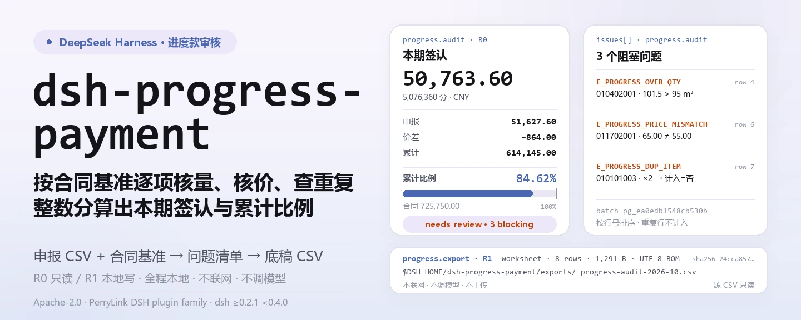
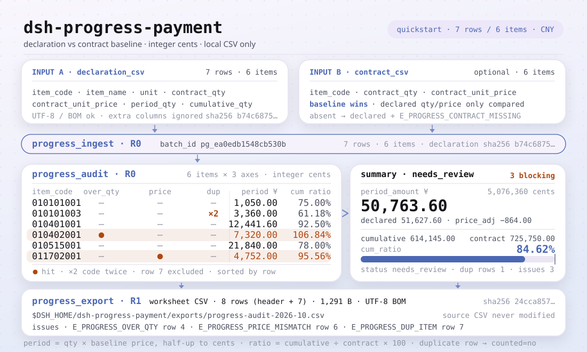

<div align="center">

<picture>
  <source media="(prefers-color-scheme: dark)" srcset="docs/assets/dsh-progress-payment-hero-zh-dark.webp">
  95、单价 65.00≠55.00、重复项 ×2 不计入）和导出条（底稿 8 行、1,291 B、UTF-8 BOM、sha256）；数字取自 quickstart 金标样例">
</picture>

# dsh-progress-payment

**按合同基准确认本期进度款：整数分金额、累计比例、超量/单价/重复项问题清单 → 审核底稿 CSV。**

面向 DeepSeek Harness 的纯本地进度款审核工具：读一份申报 CSV 和可选的合同基准 CSV，逐项核对量与单价，算出本期金额、累计金额和累计比例，再把问题清单导成可复核的底稿——不联网、不调用模型、不上传。

[安装](#三步上手) · [配置](#配置) · [FAQ](#faq) · [简体中文](README.md) · [English](README.en.md) · [Español](README.es.md) · [Português](README.pt.md) · [हिन्दी](README.hi.md)

[](LICENSE)
[](#兼容性)
[](https://www.npmjs.com/package/dsh-progress-payment)
[](https://github.com/PerryLink/dsh-progress-payment/actions/workflows/ci.yml)
[](#兼容性)

[](https://github.com/PerryLink/dsh-progress-payment/stargazers)
[](https://www.npmjs.com/package/dsh-progress-payment)

```sh
dsh plugin --profile <profile> add dsh-progress-payment
```

</div>

<sub>社区插件，与 DeepSeek 官方无关。唯一仓库：<https://github.com/PerryLink/dsh-progress-payment>。</sub>

<sub>状态：alpha / 公开合成 / partial / not counted / 非 GA——不含客户数据、客户证据，也不作生产可用或审计结论声明。</sub>

## 它是什么

把总包、分包或业主方报上来的本期进度款申报，按合同基准逐项核对：量有没有超合同、单价有没有被改动、清单项有没有重复；然后用整数分算出本期金额、累计金额和累计比例，最后给出一份可复核的审核底稿 CSV。

- **适合**：造价、监理和商务人员每期几十到几千条清单项的进度款申报；先核对量和单价，再决定本期签认多少；把申报、合同基准和问题清单留成一份可复核的 CSV 底稿；需要稳定错误码和可复跑金标样例的场景。
- **不适合**：替代计价软件、结算审核或法律意见；判断变更签证、索赔、质量扣款、税率和支付比例是否成立（本包只按合同基准提示超量，不替你做变更审批）；扫描件/PDF/图片的 OCR（只收 CSV）；没有合同基准却要求独立核验量价的申报（没有基准时只能用申报自带值计算，并会在问题清单里留痕）。

<picture>
  <source media="(prefers-color-scheme: dark)" srcset="docs/assets/dsh-progress-payment-flow-v5-dark.svg">
  
</picture>

## 三步上手

1. **安装**（三选一）：

   ```sh
   # npm 通道（推荐，已发布版本）
   dsh plugin --profile <profile> add dsh-progress-payment
   # git 通道（最新 main；等价于 git+https://github.com/PerryLink/dsh-progress-payment.git）
   dsh plugin --profile <profile> add github:PerryLink/dsh-progress-payment
   # tarball 通道：本仓库 pnpm pack 后
   dsh plugin --profile <profile> add ./dsh-progress-payment-<version>.tgz
   ```

2. **最小配置**（无需任何 Config 键，`cordis.patch.yml` 只插入这一行）：

   ```yaml
   - insert:
       - id: dsh-progress-payment
         name: 'dsh-progress-payment'
   ```

3. **验证已生效**：

   ```sh
   dsh --profile <profile> --dump-config | grep dsh-progress-payment
   node samples/quickstart/run.mjs --check
   ```

**卸载**：`dsh plugin --profile <profile> remove dsh-progress-payment`（或从 profile patch 删掉该行）。

## 核心能力

工具名是稳定 API；工具说明保留英文以匹配运行时输出。

| 工具 | 用途 | 风险 |
|---|---|---|
| `progress_ingest` | 导入本期申报 CSV 与可选合同基准 CSV，返回 `batch_id`、行数、清单项数和 sha256；批次只存在当前会话内存 | R0 |
| `progress_audit` | 审核：本期金额、累计比例、超合同量、单价不符、合同基准缺失/不符、累计小于本期、重复清单项；返回问题清单，金额整数分 | R0 |
| `progress_export` | 重跑审核并写审核底稿 CSV（UTF-8 BOM），返回路径、行数、字节数和 sha256 | R1 本地写 |

- **合同基准优先** —— 给了基准就以基准的量和单价为准；申报里自带的合同量/单价只作对照，不一致会报 `E_PROGRESS_CONTRACT_MISMATCH` 或 `E_PROGRESS_PRICE_MISMATCH`。
- **整数分金额** —— 数量最多 3 位小数、单价/金额最多 2 位；金额全程整数分、按分四舍五入，不做浮点累加。
- **累计口径** —— 每个清单项给出本期金额、累计金额、合同金额和累计比例（保留 2 位，合同金额为 0 时返回 0）；累计比例超过 100% 就是超量的直观信号。
- **问题清单带下一步** —— 6 类审核问题（`E_PROGRESS_*`）与 7 类输入/导出错误，每条都是「一句人话（错误码）｜下一步：一个动作」。
- **审核底稿 CSV** —— 一行一条申报记录，重复行标 `是否计入=否`；UTF-8 BOM，Excel 直接打开不乱码，导出结果带 sha256。
- **纯本地** —— 不联网、不调用模型、不上传；源 CSV 只读，永不修改。

## 输入

- **申报 CSV**：UTF-8，表头 `清单编码,名称,单位,合同量,合同单价,本期完成量,累计完成量`；也接受英文表头 `item_code,item_name,unit,contract_qty,contract_unit_price,period_qty,cumulative_qty`。列顺序随意，多出的列会被忽略；带 BOM 的 UTF-8 CSV 也能识别。
- **合同基准 CSV**（可选）：`清单编码,合同量,合同单价`（英文 `item_code,contract_qty,contract_unit_price`），可另有名称/单位列；一条清单只能一行，重复清单编码会报 `E_PROGRESS_CSV_ROW`。给了基准就以基准为权威；不给就用申报里的合同量/单价。
- **格式约定**：数量最多 3 位小数，单价最多 2 位；合同量必须大于 0；金额按整数分解析，`¥`、`￥`、千分位逗号会被忽略。
- **样例**：`samples/quickstart/input/declaration-2026-10.csv`（7 行 / 6 个清单项）和 `contract-baseline.csv`（6 项），全部为合成数据，虚构清单编码和金额。

## 输出

- `progress_ingest`：`batch_id`、`rows`、`items`、`contract_items`、`declaration_sha256`、`contract_sha256`；同一对 CSV 的 `batch_id` 是确定的，但批次只存在当前会话内存，不落盘。
- `progress_audit`：`items[]` 给出每个清单项的合同量/单价、本期完成量、累计完成量、本期金额、累计金额、合同金额、累计比例和问题代码；`issues[]` 按行号排序；`summary` 给出本期/申报/合同金额、差额、累计比例、问题计数和 `status`（`ok` / `needs_review`）；金额都是整数分。
- `progress_export`：审核底稿 CSV（UTF-8 BOM，Excel 直接打开不乱码），表头为 `行号,清单编码,名称,单位,合同量,合同单价(元),本期完成量,累计完成量,本期金额(元),累计金额(元),累计比例(%),是否计入,问题代码,问题说明`；一行一条申报记录，重复行标 `是否计入=否`；写到 `$DSH_HOME/dsh-progress-payment/exports/`，返回路径、行数、字节数和 sha256。
- **不改原 CSV**，不上传、不联网、不调用模型。

### 审核规则

1. **金额**：`本期金额 = 本期完成量 × 合同单价`，按整数分四舍五入到整分；累计金额同理。金额超出 JavaScript 安全整数范围时报 `E_PROGRESS_CSV_ROW`。
2. **累计比例**：`累计金额 ÷ 合同金额 × 100`，保留 2 位小数；合同金额为 0 时返回 0。
3. **超合同量**：`本期完成量 > 合同量` 或 `累计完成量 > 合同量` → `E_PROGRESS_OVER_QTY`；两者用 `kind` 区分（`period_over_contract` / `cumulative_over_contract`）。
4. **单价不符**：申报合同单价 ≠ 合同基准单价 → `E_PROGRESS_PRICE_MISMATCH`；可用 `price_tolerance_bps` 放宽容差（默认 0，精确比对），本期金额始终按合同基准单价重算。
5. **累计 > 合同量**：即第 3 条的 `cumulative_over_contract`，累计比例会超过 100%；超量部分不会自动扣减合同额，需要走变更或结算。
6. **重复清单项**：同一个清单编码出现多次 → `E_PROGRESS_DUP_ITEM`；只按第一次出现的行计入本期金额，其余行在底稿里标 `是否计入=否`。
7. **合同基准缺失 / 合同量不符**：`E_PROGRESS_CONTRACT_MISSING` / `E_PROGRESS_CONTRACT_MISMATCH`；缺失时回退用申报值计算并标问题，不能当作已核验。
8. **累计小于本期**：`E_PROGRESS_QTY_INCONSISTENT`，通常是上期累计填错。

## 示例

直接复制下面这句发给 agent：

> 帮我审一下这期进度款申报，按合同基准核对超量和单价，把问题清单导成底稿。

用自带样例复跑并核对金标：

```sh
node samples/quickstart/run.mjs --check
```


样例是一次真实运行：7 行申报 / 6 个清单项，本期金额 **50,763.60 CNY**，累计 **614,145.00 CNY（84.62%）**，3 个阻塞问题——矩形柱累计 101.5 m³ 超合同量 95 m³、基础模板申报单价 65.00 与合同基准 55.00 不符、挖沟槽土方重复出现 2 次；底稿 8 行（表头 + 7 条申报）、1,291 字节。金标 `samples/quickstart/expected/result.json` 由 `node samples/quickstart/run.mjs --json` 真实产生，不是手写；原始日志见 [`docs/assets/quickstart.log`](docs/assets/quickstart.log)。

## 配置

本插件**没有 Config 键**——挂载后即全部可用，所有可调项都在三个工具的调用参数上：

| 工具 | 参数 | 必填 | 含义 |
|---|---|---|---|
| `progress_ingest` | `declaration_csv` | 是 | 本期申报 CSV 的文本内容（工具面直接传文件内容） |
| `progress_ingest` | `contract_csv` | 否 | 合同基准 CSV 的文本内容；不传就只用申报自带的合同量/单价 |
| `progress_ingest` | `source_name` | 否 | 申报来源名，默认 `declaration.csv`，只作标识 |
| `progress_audit` | `batch_id` | 是 | `progress_ingest` 返回的批次 id |
| `progress_audit` | `price_tolerance_bps` | 否 | 单价容差，单位万分之一；默认 0（精确比对），传负数/NaN 报 `E_PROGRESS_OPTION_INVALID` |
| `progress_export` | `batch_id` | 是 | 同上 |
| `progress_export` | `filename` | 否 | 导出文件名，只允许 `[A-Za-z0-9._-]`、最长 120 字符；默认 `progress-audit-<batch 短号>.csv` |
| `progress_export` | `price_tolerance_bps` | 否 | 重跑审核时的单价容差，默认 0 |

调用示例（工具面）：

```sh
# 1) 导入申报（工具面）
#    progress_ingest({ declaration_csv, contract_csv })

# 2) 审核（工具面）
#    progress_audit({ batch_id })

# 3) 导出底稿（工具面）
#    progress_export({ batch_id, filename: "progress-audit-2026-10.csv" })
```

测试可用环境变量 `DSH_PROGRESS_PAYMENT_HOME` 覆盖本地写根目录；默认严格等于 `$DSH_HOME/dsh-progress-payment`。

## FAQ

<details>
<summary>为什么本期金额和我自己算的不一样？</summary>

本包按**合同基准单价**计算本期金额，不用申报里填的单价。申报单价和基准不一致时会报 `E_PROGRESS_PRICE_MISMATCH`，并把「按申报单价算的金额」（`declared_period_amount_cents`）和「按合同单价算的金额」（`period_amount_cents`）都列出来，差额在 `summary.price_adjustment_cents`。数量×单价按分四舍五入到整数分，不累加浮点误差。

</details>

<details>
<summary>「超合同量」到底按哪一版合同量？</summary>

给了合同基准就以基准为准；没给才用申报里的合同量。本期完成量超过合同量、累计完成量超过合同量都会报 `E_PROGRESS_OVER_QTY`，两者用 `kind` 区分（`period_over_contract` / `cumulative_over_contract`）。超量部分不会自动扣减合同额，需要走变更或结算。

</details>

<details>
<summary>重复清单项会重复算钱吗？</summary>

不会。同一清单编码出现多次时，只按第一次出现的行计入本期金额，其余行在底稿里标 `是否计入=否`，并报 `E_PROGRESS_DUP_ITEM`。但哪一行才是「本期应报的」需要你确认，本包不自动挑。

</details>

<details>
<summary>会改我的 CSV 或上传数据吗？</summary>

不会。只读用户指定的 CSV；只在本地 `$DSH_HOME/dsh-progress-payment/exports/` 写底稿；不联网、不调用模型、不上传。`progress_ingest` 的批次只存在当前会话内存里，换会话后需要重新导入。

</details>

<details>
<summary>能直接读 Excel 吗？</summary>

不能。请先在 Excel「另存为 → CSV UTF-8」。带 BOM 的 UTF-8 CSV 也能正确识别；只支持 CSV，不支持 xlsx、PDF 或扫描件。

</details>

## 权限

读：用户指定的申报 CSV 和合同基准 CSV（样例 `samples/quickstart/input/`）；不读其他目录。
写：`$DSH_HOME/dsh-progress-payment/exports/`（审核底稿 CSV）；不改原文件。
联网：否。
外部系统：无。

`progress_ingest`、`progress_audit` 标 **R0**（只读；`ingest` 只把批次写进当前会话内存，不落盘）；`progress_export` 标 **R1**（本地写，只写 `$DSH_HOME/dsh-progress-payment/exports/`）。测试可用 `DSH_PROGRESS_PAYMENT_HOME` 覆盖本地写根目录，默认严格等于 `$DSH_HOME/dsh-progress-payment`。

## 验收证据

公开/合成 fixture 在 `samples/quickstart/`；`ACCEPTANCE.csv` 记录检查，除 quickstart 行外均为 `counted=false`。

| req_id | metric | threshold | actual | pass | source | counted |
|---|---|---|---|---|---|---|
| PG-A02 | period amount (cents) | 5076360 | 5076360 | true | public/synthetic | false |
| PG-A06 | price mismatch | E_PROGRESS_PRICE_MISMATCH x1 | 1 | true | public/synthetic | false |
| PS1-QS01 | quickstart golden | 1/1 | 1 | true | synthetic/quickstart | true |

*这是 fixture 支撑的验收行，不是客户运行；没有编造输出。*

## 边界与已知限制

- **只做量价核对**：不判断变更签证、索赔、质量扣款、税率和支付比例是否合理；这些仍需合同条款和人工判断。
- **单价只有一个口径**：申报里的 `合同单价` 是本期计价依据；没有「本期单价/信息价」列。
- **不自动挑选重复行**：重复清单项会全部列出并只计第一行，哪行应报需要人工确认。
- **金额上限**：单行金额需落在 JavaScript 安全整数范围内；超出会报 `E_PROGRESS_CSV_ROW`。
- **只收 CSV**：不支持 xlsx、PDF、扫描件；Excel 请先另存为 CSV。
- 仅公开/合成样例；alpha/partial、not counted，不作 GA 或生产可用声明。

## 兼容性

| 维度 | 状态 |
|---|---|
| Harness | `dsh >=0.2.1-rc.3 <0.4.0` |
| Node | `>=24.9.0 <25` |
| 平台 | 全平台；仅本地文件 |
| 数据 | 不联网、不调用模型、不上传 |

## 生态与质量

- [npm 包页](https://www.npmjs.com/package/dsh-progress-payment)（版本与下载量）
- [CI 工作流](https://github.com/PerryLink/dsh-progress-payment/actions/workflows/ci.yml)（`ci.yml`：构建、lint、类型检查、测试、验收门）
- [故障排查](TROUBLESHOOTING.md)（按「症状 / 原因 / 动作」写的 10 类真实报错）
- [生态实测知识库](https://perrylink.github.io/dsh-plugin-guide/)：插件开发指南 · 选型实测数据 · 维护取舍判据

## 相关项目

- [dsh-ifc-qto](https://github.com/PerryLink/dsh-ifc-qto)（模型工程量，可作为申报量的对照）
- [dsh-ap-three-way](https://github.com/PerryLink/dsh-ap-three-way)（付款单三单匹配）
- [领域索引](https://perrylink.github.io/dsh-plugins/)

## 开发

```sh
pnpm install --frozen-lockfile
pnpm build && pnpm lint && pnpm typecheck
node --test test/*.test.mjs
node scripts/gate.mjs
```

当前版本 `0.2.0`，33 项测试通过（`node --test test/*.test.mjs`）。发布门禁 `node scripts/gate.mjs` = 元数据 lint + 公开验收行全过 + quickstart 金标行存在。开头横幅与结构图由 [`scripts/gen-readme-assets.py`](scripts/gen-readme-assets.py) 程序化生成（Pillow 出 1440×576 深浅双版 webp，手写 SVG 出 1100×660 结构图；图内数字逐字取自 `samples/quickstart/expected/result.json`；没有 benchmark 数据，所以不生成 evidence 图），可重复执行；`docs/assets/quickstart.png` 为真实运行截图，配合 `docs/assets/quickstart.log` 保留。

Topics：`dsh`、`dsh-plugin`、`deepseek-harness`、`progress-payment`、`construction`、`quantity-surveying`、`csv`、`perrylink`

## 家族与致谢

本项目是 [PerryLink](https://github.com/PerryLink) 维护的 DeepSeek Harness 插件家族成员（全部 Apache-2.0）。如果这个插件帮到了你，**给个 star**——它不解锁任何功能，但会让下一个人更容易找到它。

- [@PerryLink](https://github.com/PerryLink) —— 创建者与维护者：进度款审核引擎、整数分金额、CSV 解析与底稿导出、三个工具面、quickstart 金标样例与五语文档。

## License

[LICENSE](LICENSE)（Apache License 2.0）© 2026 dsh-progress-payment contributors。另见 `NOTICE`、`THIRD-PARTY-NOTICES`。

<p align="center"><sub>Apache-2.0 · 社区插件，与 DeepSeek 无关。</sub></p>
