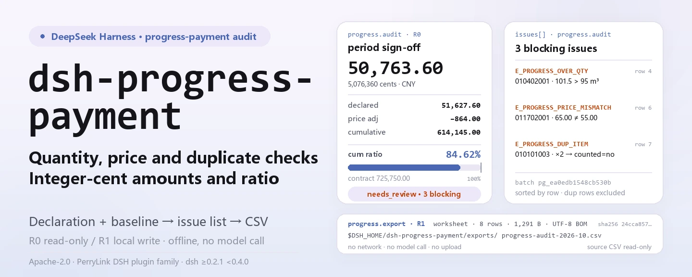
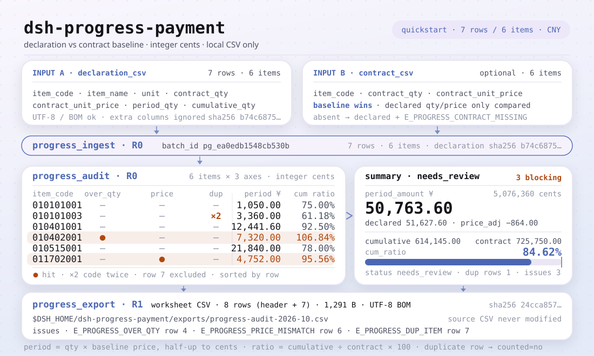

<div align="center">

<picture>
  <source media="(prefers-color-scheme: dark)" srcset="docs/assets/dsh-progress-payment-hero-en-dark.webp">
   95, preço 65.00 ≠ 55.00, duplicado ×2 não contado) e a faixa de exportação de 8 linhas (1,291 B, UTF-8 BOM, sha256); números do exemplo quickstart">
</picture>

# dsh-progress-payment

**Confirma o pagamento por medição do período contra a linha de base do contrato: valores em centavos inteiros, razão acumulada e lista de problemas (quantidade excedida, preço divergente, itens duplicados) → CSV da planilha de revisão.**

Uma ferramenta totalmente local de auditoria de pagamentos por medição para o DeepSeek Harness: lê um CSV de declaração e, opcionalmente, um CSV da linha de base do contrato; confere quantidade e preço item a item; calcula o valor do período, o acumulado e a razão acumulada; e exporta uma planilha revisável — sem rede, sem chamada ao modelo, sem upload.

[Instalar](#instalação-em-três-passos) · [Configuração](#configuração) · [FAQ](#faq) · [简体中文](README.md) · [English](README.en.md) · [Español](README.es.md) · [Português](README.pt.md) · [हिन्दी](README.hi.md)

[](LICENSE)
[](#compatibilidade)
[](https://www.npmjs.com/package/dsh-progress-payment)
[](https://github.com/PerryLink/dsh-progress-payment/actions/workflows/ci.yml)
[](#compatibilidade)

[](https://github.com/PerryLink/dsh-progress-payment/stargazers)
[](https://www.npmjs.com/package/dsh-progress-payment)

```sh
dsh plugin --profile <profile> add dsh-progress-payment
```

</div>

<sub>Plugin da comunidade, não afiliado ao DeepSeek. Repositório canônico: <https://github.com/PerryLink/dsh-progress-payment>.</sub>

<sub>Status: alpha / público-sintético / partial / not counted / não GA — sem dados de clientes, sem evidência de clientes e sem declaração de prontidão para produção ou de conclusão de auditoria.</sub>

## O que é

Pega a declaração de pagamento por medição do período enviada pela empreiteira principal, subcontratada ou proprietário e confere item a item contra a linha de base do contrato: alguma quantidade ultrapassa o contrato, algum preço unitário foi alterado, algum código de item aparece duas vezes? Depois calcula em centavos inteiros o valor do período, o valor acumulado e a razão acumulada e entrega um CSV de planilha de revisão.

- **Encaixa**: engenheiros de custos, medidores e fiscais de obra que auditam um pagamento mensal com dezenas a milhares de itens; conferir quantidade e preço antes de assinar o certificado; manter declaração, linha de base e lista de problemas em um único CSV revisável; fluxos que precisam de códigos de erro estáveis e de um exemplo dourado reproduzível.
- **Não encaixa**: substituir software de medição ou liquidação, ou parecer jurídico; decidir se uma alteração, reclamação, retenção, imposto ou razão de pagamento é válido (este pacote sinaliza excesso de quantidade, mas não aprova variações); OCR de PDF digitalizado ou imagem (apenas CSV); verificação independente de quantidade e preço sem linha de base do contrato (sem linha de base usam-se os valores declarados e a lacuna fica registrada na lista de problemas).

<picture>
  <source media="(prefers-color-scheme: dark)" srcset="docs/assets/dsh-progress-payment-flow-v5-dark.svg">
  
</picture>

## Instalação em três passos

1. **Instale** (escolha um canal):

   ```sh
   # canal npm (recomendado; versões publicadas)
   dsh plugin --profile <profile> add dsh-progress-payment
   # canal git (main mais recente; equivalente a git+https://github.com/PerryLink/dsh-progress-payment.git)
   dsh plugin --profile <profile> add github:PerryLink/dsh-progress-payment
   # canal tarball: pnpm pack neste repo e depois
   dsh plugin --profile <profile> add ./dsh-progress-payment-<version>.tgz
   ```

2. **Configuração mínima** (nenhuma chave de Config; `cordis.patch.yml` apenas insere esta linha):

   ```yaml
   - insert:
       - id: dsh-progress-payment
         name: 'dsh-progress-payment'
   ```

3. **Verifique que monta**:

   ```sh
   dsh --profile <profile> --dump-config | grep dsh-progress-payment
   node samples/quickstart/run.mjs --check
   ```

**Desinstalar**: `dsh plugin --profile <profile> remove dsh-progress-payment` (ou remova a linha do patch do perfil).

## Capacidades principais

Os nomes das ferramentas são API estável; as descrições permanecem em inglês para coincidir com a saída em tempo de execução.

| Ferramenta | Propósito | Risco |
|---|---|---|
| `progress_ingest` | Importa o CSV de declaração e o CSV opcional da linha de base; devolve `batch_id`, linhas, número de itens e sha256; o lote só vive na memória da sessão | R0 |
| `progress_audit` | Audita valor do período, razão acumulada, quantidade acima do contrato, preço divergente, linha de base ausente/divergente, acumulado menor que o período e itens duplicados; devolve a lista de problemas; centavos inteiros | R0 |
| `progress_export` | Reexecuta a auditoria e grava o CSV da planilha de revisão (UTF-8 BOM); devolve caminho, linhas, bytes e sha256 | R1 gravação local |

- **A linha de base manda** — quando fornecida, suas quantidades e preços são a autoridade; a quantidade/preço de contrato declarados servem apenas de contraste, e uma diferença gera `E_PROGRESS_CONTRACT_MISMATCH` ou `E_PROGRESS_PRICE_MISMATCH`.
- **Dinheiro em centavos inteiros** — quantidades até 3 casas, preços/valores até 2; todo valor é calculado em centavos inteiros e arredondado ao centavo, sem acumular erro de ponto flutuante.
- **Visão acumulada** — cada item informa o valor do período, o valor acumulado, o valor de contrato e a razão acumulada (2 casas, 0 quando o valor de contrato é zero); uma razão acima de 100% é o sinal visível de excesso.
- **Problemas com próxima ação** — 6 códigos de problema de auditoria (`E_PROGRESS_*`) e 7 códigos de erro de entrada/exportação, cada um como uma frase + código + uma próxima ação.
- **CSV da planilha de revisão** — uma linha por linha de declaração, duplicadas marcadas `是否计入=否`; UTF-8 BOM para o Excel abrir bem, com checksum sha256.
- **Somente local** — sem rede, sem chamada ao modelo, sem upload; os CSVs de origem são somente leitura e nunca são alterados.

## Entrada

- **CSV de declaração**: UTF-8 com linha de cabeçalho. Cabeçalhos em chinês e em inglês funcionam; a ordem das colunas é livre e colunas extras são ignoradas. BOM UTF-8 é aceito.

```text
清单编码,名称,单位,合同量,合同单价,本期完成量,累计完成量
item_code,item_name,unit,contract_qty,contract_unit_price,period_qty,cumulative_qty
```

- **CSV da linha de base do contrato** (opcional): `item_code,contract_qty,contract_unit_price` (ou `清单编码,合同量,合同单价`), com colunas opcionais de nome/unidade; uma linha por código de item e uma duplicata gera `E_PROGRESS_CSV_ROW`. Quando fornecida, é a autoridade; caso contrário, usam-se a quantidade e o preço declarados.
- **Precisão**: quantidades até 3 casas, preços unitários até 2; a quantidade de contrato deve ser maior que 0; o dinheiro é lido como centavos inteiros e `¥`, `￥` e separadores de milhar são ignorados.
- **Exemplo**: `samples/quickstart/input/declaration-2026-10.csv` (7 linhas / 6 itens) e `contract-baseline.csv` (6 itens). Apenas dados sintéticos.

## Saída

- `progress_ingest`: `batch_id`, `rows`, `items`, `contract_items`, `declaration_sha256`, `contract_sha256`. O `batch_id` é determinístico para o mesmo par de CSV, mas o lote só vive na memória da sessão e não é persistido.
- `progress_audit`: `items[]` com quantidade/preço de contrato, quantidade do período, quantidade acumulada, valor do período, valor acumulado, valor de contrato, razão acumulada e códigos de problema; `issues[]` ordenado por linha; `summary` com valores do período/declarado/contrato, ajuste de preço, razão acumulada, contagens e `status` (`ok` / `needs_review`). Todos os valores são centavos inteiros.
- `progress_export`: CSV da planilha de revisão (UTF-8 BOM, pronto para Excel) com cabeçalho `行号,清单编码,名称,单位,合同量,合同单价(元),本期完成量,累计完成量,本期金额(元),累计金额(元),累计比例(%),是否计入,问题代码,问题说明`; uma linha por linha de declaração, duplicadas marcadas `是否计入=否`; gravado em `$DSH_HOME/dsh-progress-payment/exports/` e devolve caminho, linhas, bytes e sha256.
- **Os CSVs de origem nunca são alterados**; nada é enviado e não há rede nem chamada ao modelo.

### Regras de auditoria

1. **Valor**: `valor do período = quantidade do período × preço unitário de contrato`, arredondado ao centavo inteiro; o valor acumulado é calculado da mesma forma. Um valor fora do intervalo inteiro seguro do JavaScript gera `E_PROGRESS_CSV_ROW`.
2. **Razão acumulada**: `valor acumulado ÷ valor de contrato × 100`, 2 casas; valor de contrato zero devolve 0.
3. **Quantidade acima do contrato**: `period_qty > contract_qty` ou `cumulative_qty > contract_qty` → `E_PROGRESS_OVER_QTY`, distinguido por `kind` (`period_over_contract` / `cumulative_over_contract`).
4. **Preço divergente**: preço unitário declarado ≠ preço da linha de base → `E_PROGRESS_PRICE_MISMATCH`; `price_tolerance_bps` relaxa a comparação (0 por padrão = exata). O valor do período é sempre recalculado pelo preço da linha de base.
5. **Acumulado > quantidade de contrato**: a variante `cumulative_over_contract`; a razão pode passar de 100%. O excesso não é deduzido automaticamente: exige alteração ou liquidação.
6. **Item duplicado**: o mesmo código aparece mais de uma vez → `E_PROGRESS_DUP_ITEM`; só a primeira ocorrência conta para o valor do período e as demais são marcadas `是否计入=否` na planilha.
7. **Linha de base ausente ou divergente**: `E_PROGRESS_CONTRACT_MISSING` / `E_PROGRESS_CONTRACT_MISMATCH`; se faltar um item, usam-se os valores declarados e ele é sinalizado, portanto não deve ser tratado como verificado.
8. **Acumulado menor que o período**: `E_PROGRESS_QTY_INCONSISTENT`, normalmente um acumulado inicial informado errado.

## Exemplo

Cole esta frase no agente:

```text
帮我审一下这期进度款申报，按合同基准核对超量和单价，把问题清单导成底稿。
```

Reproduza o exemplo incluído e compare com o arquivo dourado:

```sh
node samples/quickstart/run.mjs --check
```


É uma execução real: 7 linhas de declaração / 6 itens, valor do período **50.763,60 CNY**, acumulado **614.145,00 CNY (84,62%)** e 3 problemas bloqueantes — a coluna retangular chegou a 101,5 m³ acumulados contra 95 m³ de contrato, o preço da forma era 65,00 contra 55,00 da linha de base, e um código apareceu duas vezes. A planilha tem 8 linhas (cabeçalho + 7) e 1.291 bytes. `samples/quickstart/expected/result.json` é a saída real de `node samples/quickstart/run.mjs --json`, não foi escrito à mão; o log original está em [`docs/assets/quickstart.log`](docs/assets/quickstart.log).

## Configuração

Este plugin **não tem chaves de Config** — tudo é ajustado pelos parâmetros de chamada das três ferramentas:

| Ferramenta | Parâmetro | Obrigatório | Significado |
|---|---|---|---|
| `progress_ingest` | `declaration_csv` | sim | Conteúdo de texto do CSV de declaração do período |
| `progress_ingest` | `contract_csv` | não | Conteúdo de texto do CSV da linha de base; sem ele usam-se a quantidade e o preço declarados |
| `progress_ingest` | `source_name` | não | Rótulo de origem, padrão `declaration.csv`; apenas identificação |
| `progress_audit` | `batch_id` | sim | Id do lote devolvido por `progress_ingest` |
| `progress_audit` | `price_tolerance_bps` | não | Tolerância de preço unitário em pontos-base; 0 por padrão (exata); valor negativo ou NaN gera `E_PROGRESS_OPTION_INVALID` |
| `progress_export` | `batch_id` | sim | Igual acima |
| `progress_export` | `filename` | não | Nome do arquivo, apenas `[A-Za-z0-9._-]`, máx. 120 caracteres; padrão `progress-audit-<id curto>.csv` |
| `progress_export` | `price_tolerance_bps` | não | Tolerância para reexecutar a auditoria, 0 por padrão |

Exemplos de chamada (superfície de ferramentas):

```sh
# 1) importar a declaração (superfície de ferramentas)
#    progress_ingest({ declaration_csv, contract_csv })

# 2) auditar (superfície de ferramentas)
#    progress_audit({ batch_id })

# 3) exportar a planilha (superfície de ferramentas)
#    progress_export({ batch_id, filename: "progress-audit-2026-10.csv" })
```

Os testes podem sobrescrever a raiz de gravação local com a variável de ambiente `DSH_PROGRESS_PAYMENT_HOME`; o padrão é exatamente `$DSH_HOME/dsh-progress-payment`.

## FAQ

<details>
<summary>Por que o valor do período difere do meu cálculo?</summary>

A auditoria valoriza cada linha pelo **preço unitário da linha de base do contrato**, não pelo preço declarado. Um preço declarado diferente gera `E_PROGRESS_PRICE_MISMATCH` e os dois valores são informados (`declared_period_amount_cents` e `period_amount_cents`); a diferença fica em `summary.price_adjustment_cents`. Quantidade × preço é arredondado ao centavo inteiro.

</details>

<details>
<summary>Qual quantidade de contrato é o teto?</summary>

A linha de base manda quando fornecida; a quantidade declarada só é usada sem linha de base. Tanto `period_qty > contract_qty` quanto `cumulative_qty > contract_qty` geram `E_PROGRESS_OVER_QTY`, distinguidos por `kind` (`period_over_contract` / `cumulative_over_contract`). O excesso não é deduzido automaticamente do valor: exige alteração ou liquidação.

</details>

<details>
<summary>Itens duplicados são pagos duas vezes?</summary>

Não. Apenas a primeira ocorrência conta para o valor do período; as demais são marcadas `是否计入=否` na planilha e geram `E_PROGRESS_DUP_ITEM`. Decidir qual linha é a correta continua sendo uma decisão humana.

</details>

<details>
<summary>Ele altera ou envia meus CSVs?</summary>

Não. Lê apenas os CSVs indicados, grava somente em `$DSH_HOME/dsh-progress-payment/exports/` e nunca usa rede, chamada ao modelo ou upload. O lote de `progress_ingest` vive na memória da sessão, então uma sessão nova precisa importar de novo.

</details>

<details>
<summary>Dá para ler Excel diretamente?</summary>

Não. Salve primeiro a planilha como **CSV UTF-8**. CSVs UTF-8 com BOM são aceitos; xlsx, PDF e digitalizações não são suportados.

</details>

## Permissões

Leitura: os CSVs de declaração e da linha de base indicados pelo usuário (exemplo: `samples/quickstart/input/`); nada mais.
Gravação: apenas `$DSH_HOME/dsh-progress-payment/exports/` (CSV da planilha de revisão); os arquivos de origem não são alterados.
Rede: não.
Sistemas externos: nenhum.

`progress_ingest` e `progress_audit` são **R0** (somente leitura; `ingest` mantém o lote na memória da sessão e não grava arquivo). `progress_export` é **R1** (gravação local em `$DSH_HOME/dsh-progress-payment/exports/`). `DSH_PROGRESS_PAYMENT_HOME` pode sobrescrever a raiz de gravação local para testes; o padrão é exatamente `$DSH_HOME/dsh-progress-payment`.

## Evidência de aceitação

Os fixtures públicos/sintéticos ficam em `samples/quickstart/`; `ACCEPTANCE.csv` registra as verificações. Todas as linhas são `counted=false` exceto a do quickstart.

| req_id | metric | threshold | actual | pass | source | counted |
|---|---|---|---|---|---|---|
| PG-A02 | period amount (cents) | 5076360 | 5076360 | true | public/synthetic | false |
| PG-A06 | price mismatch | E_PROGRESS_PRICE_MISMATCH x1 | 1 | true | public/synthetic | false |
| PS1-QS01 | quickstart golden | 1/1 | 1 | true | synthetic/quickstart | true |

*Linhas respaldadas por fixtures, não uma execução de cliente; nenhuma saída é inventada.*

## Limites e limitações conhecidas

- **Só quantidade e preço:** não julga alterações, reclamações, retenções, impostos ou razões de pagamento; isso continua exigindo o contrato e uma pessoa.
- **Uma única base de preço:** o `contract_unit_price` da declaração é a base de valorização; não há coluna de preço atual ou de índice.
- **Sem escolha automática de duplicados:** os duplicados são listados e só a primeira linha conta; uma pessoa precisa escolher a correta.
- **Teto de valor:** cada linha deve caber no intervalo inteiro seguro do JavaScript; caso contrário, `E_PROGRESS_CSV_ROW`.
- **Apenas CSV:** sem xlsx, PDF ou documentos digitalizados.
- Apenas exemplos públicos/sintéticos; alpha/partial, not counted, sem GA ou declaração de prontidão para produção.

## Compatibilidade

| Dimensão | Estado |
|---|---|
| Harness | `dsh >=0.2.1-rc.3 <0.4.0` |
| Node | `>=24.9.0 <25` |
| Plataformas | Todas; apenas arquivos locais |
| Dados | Sem rede, sem chamada ao modelo, sem upload |

## Ecossistema e qualidade

- [Página do pacote npm](https://www.npmjs.com/package/dsh-progress-payment) (versão e downloads)
- [Fluxo de CI](https://github.com/PerryLink/dsh-progress-payment/actions/workflows/ci.yml) (`ci.yml`: build, lint, typecheck, testes e portão de aceitação)
- [Solução de problemas](TROUBLESHOOTING.md) (10 falhas reais escritas como sintoma / causa / ação)
- [Base de conhecimento do ecossistema](https://perrylink.github.io/dsh-plugin-guide/) — guia de desenvolvimento de plugins · dados de seleção medidos · critérios de manutenção

## Trabalhos relacionados

- [dsh-ifc-qto](https://github.com/PerryLink/dsh-ifc-qto) (quantidades do modelo, contraste para as quantidades declaradas)
- [dsh-ap-three-way](https://github.com/PerryLink/dsh-ap-three-way) (conciliação tripla fatura / pedido / recebimento)
- [Índice de domínio](https://perrylink.github.io/dsh-plugins/)

## Desenvolvimento

```sh
pnpm install --frozen-lockfile
pnpm build && pnpm lint && pnpm typecheck
node --test test/*.test.mjs
node scripts/gate.mjs
```

Versão atual `0.2.0`; 33 testes passam (`node --test test/*.test.mjs`). Portão de publicação `node scripts/gate.mjs` = lint de metadados + todas as linhas públicas de aceitação verdes + a linha contada do quickstart presente. O banner e o diagrama de estrutura são gerados por [`scripts/gen-readme-assets.py`](scripts/gen-readme-assets.py) (Pillow para os quatro banners webp de 1440x576, SVG escrito à mão para o diagrama de 1100x660; cada número é copiado de `samples/quickstart/expected/result.json`; não há dados de benchmark, então nenhum gráfico de evidência é emitido) e podem ser reexecutados; `docs/assets/quickstart.png` é uma captura real, mantida junto com `docs/assets/quickstart.log`.

Topics: `dsh`, `dsh-plugin`, `deepseek-harness`, `progress-payment`, `construction`, `quantity-surveying`, `csv`, `perrylink`

## Família e agradecimentos

Este projeto faz parte da família de plugins do DeepSeek Harness mantida pela [PerryLink](https://github.com/PerryLink) (todos Apache-2.0). Se for útil, **uma estrela ajuda a próxima pessoa a encontrá-lo** — nada é desbloqueado por isso.

- [@PerryLink](https://github.com/PerryLink) — criador e mantenedor: o motor de auditoria de pagamentos por medição, o dinheiro em centavos inteiros, o parser CSV e o exportador da planilha, as três superfícies de ferramentas, o exemplo dourado do quickstart e a documentação em cinco idiomas.

## Licença

[LICENSE](LICENSE) (Apache License 2.0) © 2026 dsh-progress-payment contributors. Veja também `NOTICE` e `THIRD-PARTY-NOTICES`.

<p align="center"><sub>Apache-2.0 · Plugin da comunidade, não afiliado ao DeepSeek.</sub></p>
